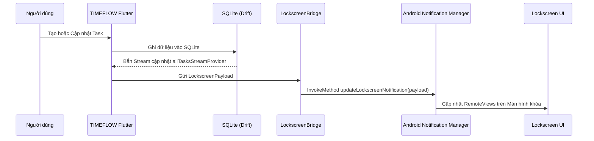
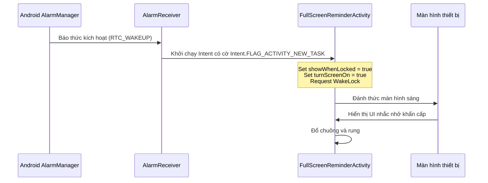

# TÀI LIỆU THIẾT KẾ KIẾN TRÚC KỸ THUẬT LOCKSCREEN
## MODULE MÀN HÌNH KHÓA CHO DỰ ÁN TIMEFLOW (PHASE 06 FOUNDATION)
**Tài liệu:** `docs/LOCKSCREEN_TECHNICAL_DESIGN.md`  
**Phiên bản:** 1.0  
**Tác giả:** Senior Flutter Architect, Mobile DevOps & Systems Engineer  
**Trạng thái:** Sẵn sàng cho Phase 06  

---

## 1. MỤC TIÊU CỦA MODULE LOCKSCREEN

TIMEFLOW là ứng dụng quản lý thời gian và công việc theo hướng **Local-first / Offline-first**. Mục tiêu tối thượng của module Lockscreen là giúp người dùng:
1. **Nắm bắt lịch trình tức thì mà không cần mở khóa điện thoại:** Giảm thiểu ma sát nhận thức, giúp người dùng tập trung vào công việc hiện tại (Current Task) và chuẩn bị cho công việc kế tiếp (Next Task).
2. **Không bỏ lỡ các công việc khẩn cấp:** Cung cấp cơ chế cảnh báo chủ động (Active Alerting) khi đến mốc deadline hoặc khung giờ quan trọng ngay cả khi thiết bị đang ở chế độ ngủ sâu (Doze Mode) hoặc màn hình đang tắt.
3. **Tương tác nhanh tại chỗ (Actionable Quick Controls):** Hỗ trợ đánh dấu hoàn thành nhanh hoặc hoãn nhắc nhở (Snooze) trực tiếp trên giao diện màn hình khóa.

---

## 2. KIẾN TRÚC TỔNG THỂ (OVERALL ARCHITECTURE)

Module Lockscreen của TIMEFLOW được thiết kế gồm **3 thành phần bổ trợ lẫn nhau**, giải quyết triệt để các giới hạn của hệ điều hành Android hiện đại:

```text
+---------------------------------------------------------------------------------------+
|                                    TIMEFLOW APP                                       |
|  +---------------------------------------------------------------------------------+  |
|  |                     FLUTTER LAYER (Dart & Riverpod)                             |  |
|  |  - Drift SQLite (Tasks Table)                                                   |  |
|  |  - TaskReminderSyncService                                                      |  |
|  |  - LockscreenBridgeService (MethodChannel)                                      |  |
|  +---------------------------------------------------------------------------------+  |
+-------------------------------------------|-------------------------------------------+
                                            | Platform Channels / SharedPreferences / Native SQLite
+-------------------------------------------v-------------------------------------------+
|                                 ANDROID NATIVE LAYER                                  |
|  +---------------------------+  +-------------------------+  +---------------------+  |
|  | 1. ONGOING NOTIFICATION   |  | 2. ANDROID APPWIDGET    |  | 3. FULL-SCREEN      |  |
|  |    (Foreground Pinned)    |  |    (Glance / HomeWidget)|  |    REMINDER         |  |
|  | - Màn hình khóa luôn sáng |  | - Widget màn hình khóa/ |  | - Đánh thức màn hình|  |
|  | - Hiển thị Current/Next   |  |   màn hình chính        |  | - showWhenLocked    |  |
|  | - Quick Action (Done)     |  | - Đồng bộ qua AppGroup  |  | - turnScreenOn      |  |
|  +---------------------------+  +-------------------------+  +---------------------+  |
+---------------------------------------------------------------------------------------+
```

1. **Thành phần 1: Ongoing Notification (Thông báo thường trực)**
   - Cơ chế: Notification thường trực (`ongoing = true`, `priority = PRIORITY_LOW`, channel `timeflow_lockscreen_status`).
   - Khả năng hiển thị: Xuất hiện trên thanh thông báo và trên màn hình khóa khi người dùng cấp quyền và cho phép hiển thị thông báo trên màn hình khóa (tuân thủ thiết lập notification privacy của từng hãng Android).
   - Nội dung: Tự động cập nhật công việc đang làm (Current Task) và công việc kế tiếp (Next Task); hỗ trợ nút mở nhanh ứng dụng.
2. **Thành phần 2: Home Screen Widget (Tiện ích màn hình chính)**
   - Cơ chế: Tích hợp thư viện `home_widget` kết hợp Android AppWidget/RemoteViews chuẩn.
   - Vị trí: Hiển thị trên màn hình chính (Home Screen) của thiết bị Android. (Lưu ý kỹ thuật: Lockscreen Widget tùy chỉnh không được hỗ trợ phổ quát trên Android hiện đại, phần lớn các bản phân phối Android 12-15 của OEM không cho phép widget bên thứ 3 đặt tự do lên màn hình khóa, vì vậy tiện ích này là Home Screen Widget, phân biệt rõ với Ongoing Notification).
   - Nội dung: Hiển thị danh sách 3–5 công việc sắp tới trong ngày, bấm vào task để mở app.
3. **Thành phần 3: Full-screen Reminder (Nhắc nhở toàn màn hình)**
   - Cơ chế: Đánh giá quyền `USE_FULL_SCREEN_INTENT` kết hợp Activity cắm cờ `showWhenLocked` và `turnScreenOn`.
   - Vị trí: Bật sáng màn hình và hiển thị hộp thoại khẩn cấp khi đến giờ hẹn báo thức nếu được cấp quyền hợp lệ và tuân thủ chính sách Android 14+ (từ Android 14, quyền `USE_FULL_SCREEN_INTENT` bị hạn chế và có thể bị thu hồi bởi người dùng hoặc hệ thống; ứng dụng phải có fallback về Notification tiêu chuẩn).

---

## 3. NGUYÊN TẮC THIẾT KẾ BẮT BUỘC (ARCHITECTURAL CONSTRAINTS)

1. **Nguồn dữ liệu duy nhất (Single Source of Truth):** Toàn bộ việc đọc và ghi dữ liệu công việc diễn ra tại tầng Flutter thông qua Drift SQLite Database và Riverpod Streams. **Tuyệt đối KHÔNG cho phép Native Android mở trực tiếp kết nối ghi vào file SQLite** để tránh race condition, hỏng database file lock và lệch cache reactive stream của Drift.
2. **Không dùng Background Polling:** Tuyệt đối không dùng `Timer.periodic` chạy nền liên tục. Chỉ cập nhật notification khi có sự kiện thay đổi dữ liệu từ Drift stream hoặc khi người dùng mở ứng dụng.
3. **Không lạm dụng Foreground Service:** Không tạo standing Foreground Service liên tục nếu không phát âm thanh hoặc không dẫn đường, tuân thủ chính sách Foreground Service của Google Play (Android 14+).
4. **Không sử dụng SYSTEM_ALERT_WINDOW:** Tôn trọng bảo mật hệ điều hành, không dùng quyền vẽ đè màn hình.
5. **Chống trùng lặp (Update Deduplication):** Tầng Flutter Bridge lưu cache payload gần nhất; nếu payload mới không thay đổi so với payload cũ thì không gửi IPC MethodChannel và không cập nhật notification để tiết kiệm pin.

---

## 3. FLUTTER LAYER DESIGN

### 3.1. LockscreenBridgeService
Service trung gian tại tầng Flutter chịu trách nhiệm:
- Lắng nghe luồng thay đổi dữ liệu từ `todayTasksStreamProvider`, `currentTaskStreamProvider`, và `nextTaskStreamProvider`.
- Đóng gói dữ liệu lịch trình hôm nay thành định dạng JSON chuẩn nhẹ (`LockscreenPayload`).
- Gửi dữ liệu xuống tầng Native qua `MethodChannel('com.timeflow.lockscreen/bridge')` hoặc ghi vào `home_widget` Key-Value store.

### 3.2. Payload Structure
```dart
class LockscreenPayload {
  final TaskItem? currentTask;
  final TaskItem? nextTask;
  final List<TaskItem> todayTasks;
  final int completedCount;
  final int totalCount;
  final String formattedDate;
  
  Map<String, dynamic> toJson();
}
```

---

## 4. ANDROID NATIVE LAYER DESIGN

### 4.1. LockscreenBroadcastReceiver
- Lắng nghe các sự kiện hệ thống:
  - `BOOT_COMPLETED` (Máy vừa khởi động).
  - `TIME_TICK` (Mỗi phút trôi qua để cập nhật thời gian còn lại của Current Task).
  - `ACTION_MY_PACKAGE_REPLACED` (Ứng dụng vừa được cập nhật).
  - `com.timeflow.ACTION_TASK_COMPLETED_QUICK` (Người dùng bấm nút "Xong" từ màn hình khóa).

### 4.2. Action Handler & Navigation Intent
- Khi người dùng bấm vào thông báo hoặc nút hành động:
  - Khởi chạy Intent có cờ `FLAG_ACTIVITY_NEW_TASK | FLAG_ACTIVITY_SINGLE_TOP` kèm payload `taskId`.
  - `MainActivity` chuyển tiếp sự kiện qua `MethodChannel` về Flutter Router (`appRouter.go('/tasks')`).
  - Toàn bộ việc cập nhật trạng thái Task được xử lý an toàn tại tầng Drift SQLite trong Flutter engine, đảm bảo dữ liệu toàn vẹn và reactive stream được cập nhật đồng bộ.

---

## 5. DATA FLOW (LUỒNG DỮ LIỆU)



---

## 6. NOTIFICATION FLOW (LUỒNG THÔNG BÁO)

1. **Kênh thông báo (Notification Channels):**
   - `timeflow_lockscreen_status`: Kênh cho Ongoing Notification ghim trên màn hình khóa (`Importance.low` hoặc `Importance.min` để không phát tiếng 'ting' mỗi lần cập nhật, không gây phiền toái).
   - `timeflow_urgent_alarms`: Kênh báo động cho công việc khẩn cấp (`Importance.high`, rung mạnh, phát âm thanh chuông nhắc việc, bật `fullScreenIntent`).
2. **Quyền riêng tư (Visibility on Lockscreen):**
   - Hỗ trợ `NotificationCompat.VISIBILITY_PUBLIC` (hiển thị đầy đủ tên công việc khi máy khóa).
   - Tôn trọng thiết lập bảo mật: Nếu người dùng bật tùy chọn "Ẩn nội dung nhạy cảm", chuyển sang hiển thị *"TIMEFLOW: Bạn có 3 công việc hôm nay"* (`VISIBILITY_PRIVATE`).

---

## 7. WIDGET DATA SYNC (ĐỒNG BỘ WIDGET NATIVE)

- Sử dụng cơ chế lưu trữ dùng chung giữa Flutter và Native Android:
  - Thư viện `home_widget` ghi dữ liệu vào `SharedPreferences` với tên file chia sẻ `timeflow_widget_prefs`.
  - Android AppWidgetProvider đọc dữ liệu từ `SharedPreferences` và gọi `AppWidgetManager.updateAppWidget()` cập nhật giao diện `RemoteViews`.
  - Hỗ trợ kích thước Widget: 4x2 (Lịch trình chi tiết) và 2x1 (Công việc hiện tại & tiếp theo).

---

## 8. FULL-SCREEN REMINDER FLOW



---

## 9. MA TRẬN QUYỀN HỆ ĐIỀU HÀNH (PERMISSION MATRIX)

| Quyền Android | Mục đích sử dụng | Bắt buộc từ Android | Mức độ kiểm duyệt Google Play |
|---|---|---|---|
| `android.permission.POST_NOTIFICATIONS` | Hiển thị Ongoing Notification và nhắc việc | Android 13+ (API 33) | Bình thường (Runtime Permission) |
| `android.permission.RECEIVE_BOOT_COMPLETED` | Khôi phục Ongoing Notification sau khởi động | Mọi phiên bản | Bình thường (Normal Permission) |
| `android.permission.SCHEDULE_EXACT_ALARM` | Lên lịch thông báo chính xác từng giây | Android 12+ (API 31) | Kiểm duyệt theo chính sách Alarm/Calendar |
| `android.permission.USE_EXACT_ALARM` | Thay thế cho SCHEDULE_EXACT_ALARM | Android 13+ | Dành riêng cho Calendar & To-do list apps |
| `android.permission.USE_FULL_SCREEN_INTENT` | Bật màn hình nhắc nhở khẩn cấp toàn màn hình | Mọi phiên bản | Cần khai báo lý do hợp lệ trên Android 14+ |
| `android.permission.WAKE_LOCK` | Đánh thức CPU và sáng màn hình khi báo thức reo | Mọi phiên bản | Bình thường |
| `android.permission.FOREGROUND_SERVICE` | Duy trì service đồng bộ nếu cần cập nhật liên tục | Android 9+ | Cần khai báo loại Service phù hợp (Android 14) |

> [!IMPORTANT]
> **Tuyệt đối KHÔNG sử dụng `SYSTEM_ALERT_WINDOW` (Vẽ đè màn hình khác):** Quyền này khiến ứng dụng bị coi là adware, bị Google Play từ chối và bị các hãng điện thoại (MIUI, ColorOS) chặn mặc định.

---

## 10. MA TRẬN TƯƠNG THÍCH ANDROID (ANDROID COMPATIBILITY MATRIX)

| Phiên bản Android | API Level | Ongoing Notification | Lockscreen Widget | Full-screen Reminder | Lưu ý kỹ thuật |
|---|:---:|:---:|:---:|:---:|---|
| **Android 8.0 - 11** | 26 - 30 | Tương thích 100% | Chỉ hỗ trợ Home Widget | Hoạt động tốt | Không cần xin quyền runtime notification |
| **Android 12 - 12L** | 31 - 32 | Tương thích 100% | Home Widget | Hoạt động tốt | Yêu cầu `SCHEDULE_EXACT_ALARM` |
| **Android 13** | 33 | Tương thích 100% | Home Widget | Hoạt động tốt | Phải xin quyền `POST_NOTIFICATIONS` lúc mở app |
| **Android 14** | 34 | Tương thích 100% | Home Widget + Shortcuts | Cần phân quyền FullScreen | Hạn chế Foreground Service types |
| **Android 15+** | 35 | Tương thích 100% | Hỗ trợ Lockscreen Spaces | Hoạt động tốt | Tuân thủ 16KB page size và edge-to-edge |

---

## 11. BẢO MẬT & QUYỀN RIÊNG TƯ (SECURITY CONSIDERATIONS)

1. **Bảo vệ nội dung riêng tư trên màn hình khóa:** Mặc định người lạ có thể nhìn thấy màn hình khóa của người dùng. Cần cung cấp tùy chọn trong Cài đặt:
   - *Chế độ Công khai (Public):* Hiện đầy đủ tên công việc và mô tả.
   - *Chế độ Riêng tư (Private):* Chỉ hiện *"TIMEFLOW: 1 công việc đang diễn ra"* và ẩn nội dung chi tiết cho đến khi người dùng mở khóa thiết bị.
2. **Không vượt mặt hệ thống bảo vệ sinh trắc học:** Tuyệt đối không can thiệp vào tiến trình khóa PIN/vân tay của hệ thống Android. Ứng dụng chỉ hiển thị thông tin như một lớp thông báo hoặc tiện ích hợp lệ.

---

## 12. TỐI ƯU HÓA PIN & DOZE MODE (BATTERY OPTIMIZATION)

1. **Tránh Background Polling vô nghĩa:** Không dùng `Timer.periodic` chạy nền liên tục gây hao pin. Chỉ cập nhật thông báo khi:
   - Dữ liệu trong SQLite thay đổi (Trigger theo sự kiện).
   - Khi hệ điều hành gửi broadcast `ACTION_TIME_TICK` (mỗi phút một lần).
2. **Hướng dẫn người dùng tắt Pin thông minh (Battery Saver whitelist):** Cung cấp màn hình hướng dẫn người dùng bật tùy chọn "Không giới hạn pin" (Unrestricted Battery) trên các dòng máy đặc thù (Xiaomi MIUI/HyperOS, Huawei HarmonyOS, Oppo ColorOS, Samsung OneUI) để tránh bị hệ thống ngắt tiến trình báo thức.

---

## 13. CHIẾN LƯỢC KIỂM THỬ (TESTING STRATEGY)

1. **Kiểm thử trên Android Emulator:**
   - Kích hoạt Doze Mode bằng lệnh ADB:
     ```bash
     adb shell dumpsys deviceidle force-idle
     ```
   - Thử nghiệm bắn báo thức lúc Doze:
     ```bash
     adb shell am broadcast -a com.google.android.c2dm.intent.RECEIVE
     ```
2. **Kiểm thử trên thiết bị Android thật:**
   - Kiểm tra hiển thị thông báo khóa khi khởi động lại máy (`BOOT_COMPLETED`).
   - Kiểm tra hành vi bấm nút "Xong" từ màn hình khóa khi máy vẫn đang khóa vân tay.
   - Kiểm tra giao diện Full-screen Reminder khi màn hình đang tắt hoàn toàn.

---

## 14. CÁC RỦI RO & PHƯƠNG ÁN XỬ LÝ

| Rủi ro | Mức độ | Phương án xử lý dự phòng |
|---|:---:|---|
| Bị hệ điều hành Xiaomi/Huawei tắt ngầm | Cao | Hướng dẫn `Auto-start` và sử dụng `AlarmManager.setExactAndAllowWhileIdle` |
| Người dùng từ chối quyền Thông báo | Trung bình | Hiển thị Banner nhắc nhở trên HomeScreen giải thích lý do cần quyền |
| Android 14 thu hồi quyền FullScreen Intent | Thấp | Fallback tự động về Heads-up Notification có nút tương tác trực tiếp |

---

## 15. TIẾN ĐỘ THỰC TẾ & LỘ TRÌNH TRIỂN KHAI PHASE 06

- **Sprint 6.1 (HOÀN THÀNH - VERIFIED):**
  - Xây dựng `LockscreenNotificationManager.kt` Native Kotlin và Flutter MethodChannel `com.timeflow.lockscreen/bridge`.
  - Ongoing Pinned Notification ID `1001` hiển thị Current Task & Next Task trên màn hình khóa.
  - Tự động đồng bộ hóa phản ứng từ Drift SQLite, chống gửi trùng lặp (deduplication cache).
  - Test suite: 57/57 tests PASS, Android Debug APK biên dịch thành công.

- **Sprint 6.2 (HOÀN THÀNH - VERIFIED):**
  - Tích hợp `home_widget` package (v0.10.0).
  - Triển khai 2 kích cỡ Android Home Screen Widget chuẩn:
    - **Compact (2×1):** `TimeflowWidgetCompactProvider.kt` + `timeflow_widget_compact.xml` (Current task, khoảng thời gian, tiến độ X/Y, empty state).
    - **Expanded (4×2):** `TimeflowWidgetExpandedProvider.kt` + `timeflow_widget_expanded.xml` (Header date tiếng Việt, tiến độ hoàn thành, thanh ProgressBar trực quan, thẻ việc Đang diễn ra & Kế tiếp, nút Mở app).
  - Xử lý bài toán chuyển đổi mốc thời gian (08:59 → 09:00): Sử dụng `calculateNextTransitionTime` tính toán mốc chuyển đổi gần nhất và `homeWidgetClockProvider` kích hoạt cập nhật chính xác tại giây 00 mà không cần polling liên tục gây hao pin.
  - Bảo vệ đa nền tảng (Windows Desktop / Web safety): Tự động phát hiện và bỏ qua lệnh gọi Native channel ngoài Android, bảo toàn khả năng chạy trên Desktop.
  - Test suite: 76/76 tests PASS, Flutter static analysis clean 0 warnings.

- **Sprint 6.3 (SẮP TRIỂN KHAI):**
  - Xây dựng `FullScreenReminderActivity` với cờ `showWhenLocked` và `turnScreenOn` cho task ưu tiên khẩn cấp (`urgent`).
  - Fallback về Heads-up Notification khi quyền `USE_FULL_SCREEN_INTENT` không được cấp hoặc bị hạn chế trên Android 14+.

- **Sprint 6.4 (DỰ KIẾN):**
  - Tích hợp tùy chọn bảo mật Lockscreen Privacy vào màn hình Cài đặt và QA toàn diện trên thiết bị Android thật.

