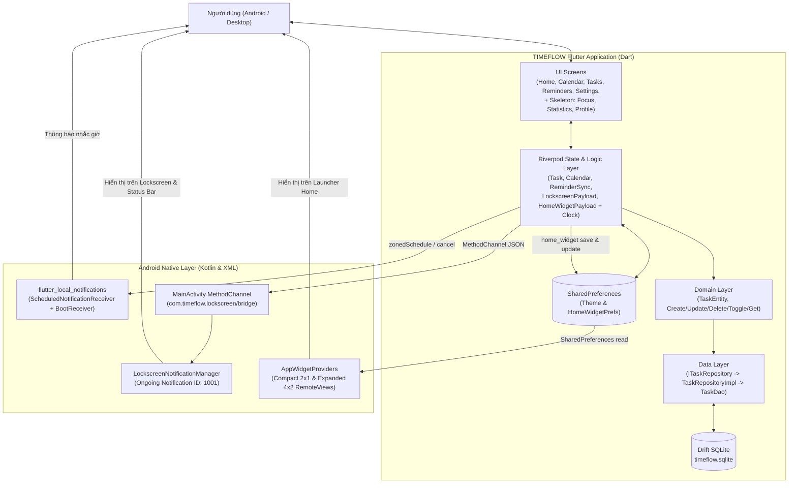

# PHẦN 1 – TỔNG QUAN SẢN PHẨM (PROJECT OVERVIEW)

**Ngày phân tích:** 12/11/2026  
**Phiên bản mã nguồn:** Commit `89cb1b6` (Release tag `v0.6.2` — Sprint 6.2)

---

## 1.1. TIMEFLOW là ứng dụng gì?

**TIMEFLOW** là ứng dụng quản lý công việc cá nhân (To-do List) kết hợp lịch trình theo khung giờ (Time-based Scheduling) và hiển thị nhanh ngoài màn hình chính/màn hình khóa (**Home Screen Widget & Lockscreen Ongoing Notification**), được xây dựng theo triết lý **Local-First / Offline-First**.

Toàn bộ dữ liệu công việc được lưu trữ cục bộ trên thiết bị bằng SQLite (thông qua Drift ORM), không phụ thuộc vào máy chủ từ xa để hoạt động các tính năng cốt lõi.

---

## 1.2. Ứng dụng giải quyết vấn đề nào của người dùng?

Các ứng dụng To-do List truyền thống thường gặp 3 vấn đề lớn:
1. **Ma sát mở khóa (Unlock Friction):** Người dùng phải mở khóa điện thoại, tìm app, mở app mới biết ngay lúc này mình cần làm gì và việc tiếp theo là gì.
2. **Thiếu ngữ cảnh thời gian thực (Lack of Time-awareness):** Danh sách việc cần làm chỉ là một list tĩnh; người dùng khó phân biệt ngay công việc *đang diễn ra tại phút hiện tại* (Current Task) với công việc *sắp tới* (Next Task).
3. **Bỏ lỡ việc khi làm việc offline hoặc tắt màn hình:** Nhắc nhở dễ bị trễ nếu không dùng cơ chế lập lịch chính xác của hệ điều hành hoặc bị mất lịch nhắc sau khi khởi động lại máy.

TIMEFLOW giải quyết bằng cách đưa **Current Task** và **Next Task** ra **Ongoing Notification trên Lockscreen** và **2 kích thước Home Screen Widget (Compact 2×1 & Expanded 4×2)**, tự động chuyển tiếp theo thời gian thực khi task kết thúc hoặc sang ngày mới.

---

## 1.3. Đối tượng người dùng mục tiêu

- **Sinh viên, học sinh:** Quản lý lịch học, deadline bài tập, lịch ôn thi theo khung giờ trong ngày.
- **Nhân viên văn phòng, lập trình viên, freelancer:** Cần theo dõi công việc đang làm (time-blocking) và cuộc họp/task kế tiếp mà không bị phân tâm bởi mạng xã hội khi mở điện thoại.
- **Người dùng ưu tiên sự riêng tư và tốc độ:** Muốn app chạy mượt, không bắt buộc đăng nhập, hoạt động 100% khi mất mạng.

---

## 1.4. Những giá trị chính mà ứng dụng mang lại

1. **Giảm ma sát nhận thức:** Nhìn thấy ngay việc đang làm (`Đang làm: ...`) và việc sắp tới (`Kế tiếp: ...`) ngay trên màn hình khóa hoặc màn hình chính Android.
2. **Nhất quán dữ liệu (Single Source of Truth):** Mọi thao tác CRUD ở màn hình Tasks/Calendar đều tự động phản ánh lên màn hình Home, Local Notifications, Lockscreen Notification và Home Screen Widgets nhờ Reactive Streams.
3. **Hoạt động Offline hoàn toàn:** Dữ liệu nằm trong `timeflow.sqlite` trên máy, phản hồi tức thì.
4. **Hỗ trợ tiếng Việt bản địa hóa tốt:** Giao diện, định dạng ngày tháng (`DateFormatter`), nhãn mức độ ưu tiên (`Thấp`, `Trung bình`, `Cao`, `Khẩn cấp`) và kênh thông báo đều thuần tiếng Việt.

---

## 1.5. Các nền tảng đang được hỗ trợ

Dựa trên cấu trúc thư mục dự án (`android/`, `windows/`, `web/`) và mã nguồn thực tế:

| Nền tảng | Mức độ hỗ trợ thực tế | Ghi chú kỹ thuật |
|---|---|---|
| **Android** | **Hỗ trợ chính (Primary)** | Đầy đủ UI Flutter, Drift SQLite, Local Notifications, Lockscreen Ongoing Notification (Kotlin `MethodChannel`), Home Screen Widgets (2×1 & 4×2 `AppWidgetProvider`). Đã build APK debug và kiểm thử trên Emulator API 36.1. |
| **Windows Desktop** | **Hỗ trợ UI & Local DB (Partial)** | Có thư mục `windows/`, có `NavigationRail` responsive cho màn hình rộng (`>= 768px` trong `lib/features/main_layout/presentation/main_layout_screen.dart`). `HomeWidgetServiceImpl` và `MethodChannelLockscreenBridge` có guard kiểm tra `defaultTargetPlatform != TargetPlatform.android` để không crash trên Windows. Chưa kiểm chứng build Windows trong phiên kiểm kê này. |
| **Web / iOS / macOS / Linux** | **Chưa cấu hình đầy đủ** | Có thư mục `web/` mặc định của Flutter; `local_notification_service.dart` có cấu hình Darwin/Linux cơ bản nhưng không có thư mục `ios/`/`macos/`/`linux/` trong repo và `home_widget` chỉ cấu hình cho Android. |

---

## 1.6. Các chức năng cốt lõi vs Nâng cao

### Chức năng cốt lõi (Đã triển khai thực tế)
- **Task CRUD & Quản lý trạng thái:** Tạo, xem, sửa, xóa, đánh dấu hoàn thành, tìm kiếm, lọc theo trạng thái (`Tất cả`, `Chưa xong`, `Đã hoàn thành`).
- **Màn hình Hôm nay (`HomeScreen`):** Hiển thị ngày hiện tại, Current Task, Next Task, lịch trình trong ngày (`TimelineScheduleWidget`).
- **Lịch tháng (`CalendarScreen`):** Lưới lịch 7 cột (T2–CN), chấm chỉ báo số lượng task theo ngày (tối đa 3 chấm), lọc task theo ngày được chọn.
- **Nhắc nhở cục bộ (`Reminders`):** Đặt nhắc nhở trước giờ bắt đầu (`Đúng giờ`, `5/10/15/30 phút`, `1 giờ`, `1 ngày`), lập lịch thông báo chính xác (`exactAllowWhileIdle`), tự động đối soát (reconcile) khi dữ liệu thay đổi, màn hình `RemindersScreen`.
- **Lockscreen Ongoing Notification (Android):** Thông báo ghim hiển thị Current Task, Next Task, tiến độ ngày (`completed/total`), mở app khi nhấn.
- **Home Screen Widgets (Android):** Compact Widget (2×1) và Expanded Widget (4×2) đồng bộ tự động qua `home_widget` và tự động cập nhật khi đến mốc thời gian chuyển task (`homeWidgetClockProvider`).
- **Cài đặt giao diện (`SettingsScreen`):** Chuyển đổi Light / Dark / System Theme và lưu bền vững qua `SharedPreferences`.

### Chức năng mới ở mức khung / thiết kế (Skeleton / Stub)
- **Tập trung / Pomodoro (`FocusScreen`):** Mới là màn hình placeholder (`lib/features/focus/presentation/focus_screen.dart`).
- **Thống kê năng suất (`StatisticsScreen`):** Mới là màn hình placeholder (`lib/features/statistics/presentation/statistics_screen.dart`).
- **Timeline chi tiết (`TimelineScreen`):** Mới là màn hình placeholder (`lib/features/timeline/presentation/timeline_screen.dart`).
- **Hồ sơ (`ProfileScreen`) & Gói Plus (`SubscriptionScreen`):** Mới là màn hình placeholder.
- **Network / Auth / Cloud Sync (`DioClient`, `AuthService`, `SyncService`, `SubscriptionService`):** Mới là các class stub rỗng, chưa kết nối backend thực tế.
- **Full-screen Reminder (`USE_FULL_SCREEN_INTENT`) & Quick Action "Done" trên Lockscreen:** Mới có trong tài liệu thiết kế `docs/LOCKSCREEN_TECHNICAL_DESIGN.md`, **chưa triển khai** trong `AndroidManifest.xml` và Kotlin code.

---

## 1.7. Điểm khác biệt so với ứng dụng To-do List thông thường

1. **Tập trung vào "Hiện tại & Kế tiếp" (Current & Next Focus):** Thay vì chỉ liệt kê hàng chục việc gây choáng ngợp, TIMEFLOW tính toán chính xác việc đang diễn ra tại thời điểm `now` và việc tiếp theo gần nhất, kể cả khi có nhiều task trùng khung giờ (giải quyết xung đột bằng độ ưu tiên).
2. **Cơ chế đồng hồ chuyển tiếp thông minh (`homeWidgetClockProvider`):** Thay vì polling mỗi giây gây hao pin, stream đồng hồ tính chính xác thời điểm chuyển giao tiếp theo (`startTime` hoặc `endTime` gần nhất hoặc đầu phút tiếp theo) để `await Future.delayed(...)` đúng lúc cần cập nhật Widget.
3. **Tích hợp sâu Android Native:** Kết hợp cả `flutter_local_notifications` (nhắc việc theo giờ hẹn), `MethodChannel` tùy biến (`LockscreenNotificationManager.kt`), và `AppWidgetProvider` (`TimeflowWidgetCompactProvider.kt`, `TimeflowWidgetExpandedProvider.kt`).

---

## 1.8. Mô tả sản phẩm theo 3 góc nhìn

- **Góc nhìn Người dùng cuối (End User):** *"Một ứng dụng nhắc việc tiếng Việt gọn nhẹ, không cần tạo tài khoản, giúp tôi nhìn thấy ngay trên màn hình khóa hoặc màn hình chính việc mình đang phải làm lúc này và việc sắp tới là gì, không bị quên deadline."*
- **Góc nhìn Nhà phát triển phần mềm (Developer):** *"Một ứng dụng Flutter áp dụng Feature-first + Clean Architecture (mức nhẹ), dùng Riverpod làm xương sống reactive state & DI, Drift SQLite làm Single Source of Truth, giao tiếp với Android Native qua `MethodChannel` và `home_widget` SharedPreferences, có bộ 87 unit/integration tests tự động."*
- **Góc nhìn Người đánh giá sản phẩm (Product Reviewer):** *"Sản phẩm đã giải quyết tốt phần lõi (Task CRUD + Calendar + Reminder + Widget + Lockscreen Ongoing Notification) và đạt chất lượng MVP vững chắc ở mảng Local-first Android. Tuy nhiên, các tab/tính năng phụ như Statistics, Focus (Pomodoro), Profile, Cloud Sync mới là màn hình giữ chỗ; đồng thời có sự thiếu đồng nhất nhỏ giữa logic chọn Current Task trên UI chính và trên Home Widget cần được thống nhất trước khi phát hành chính thức."*

---

## 1.9. Sơ đồ tổng quan các thành phần của TIMEFLOW

