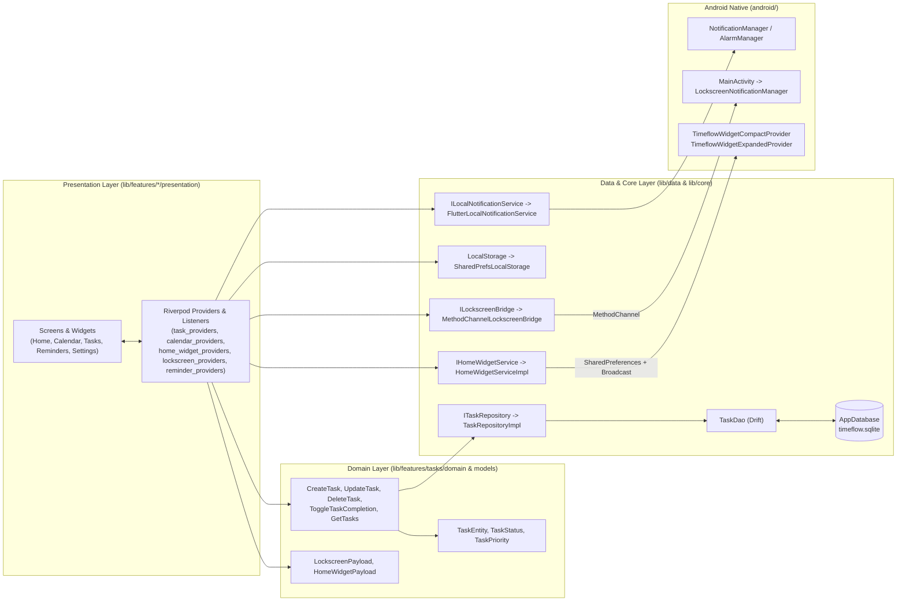
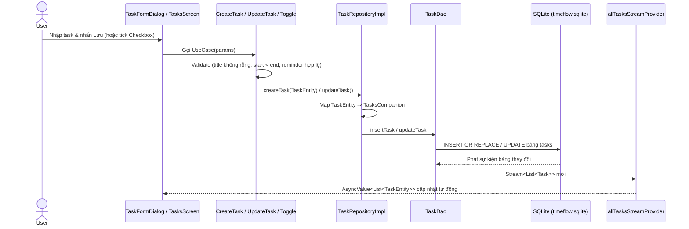
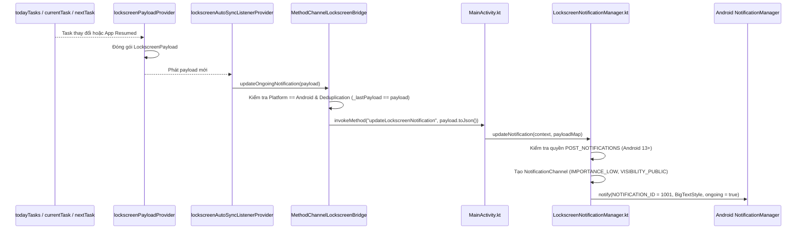
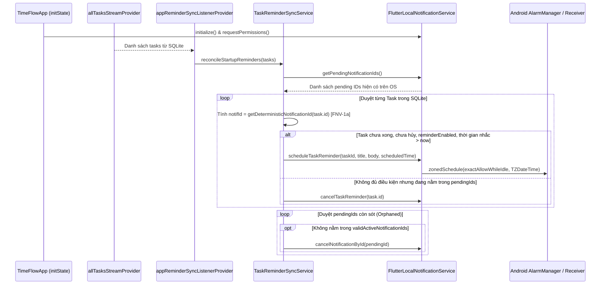
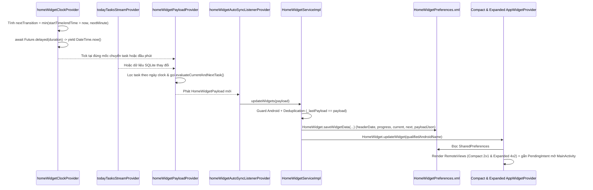

# PHẦN 3 – PHÂN TÍCH KIẾN TRÚC PHẦN MỀM (SYSTEM ARCHITECTURE)

**Ngày phân tích:** 12/11/2026  
**Phạm vi kiểm tra:** Toàn bộ `lib/`, `android/`, `test/`

---

## 3.1. Kiến trúc thực tế đang áp dụng

Qua kiểm tra toàn bộ mã nguồn, TIMEFLOW **không** áp dụng Clean Architecture thuần túy đồng đều ở mọi module, mà đang áp dụng mô hình **Feature-First + Clean Architecture (Light) + Repository Pattern**:

1. **Feature-First Organization (`lib/features/`):** Mã nguồn được chia theo từng tính năng nghiệp vụ (`tasks`, `calendar`, `home`, `reminders`, `lockscreen`, `home_widget`, `settings`, `main_layout`, và các module skeleton `focus`, `statistics`, `timeline`, `profile`, `subscription`).
2. **Clean Architecture (Light):**
   - Chỉ module `tasks` có đủ 3 tầng rõ rệt: `domain/` (`TaskEntity`, 5 UseCases), `presentation/` (`TasksScreen`, `TaskFormDialog`, `task_providers.dart`), và dùng chung tầng `data/` ở root (`lib/data/`).
   - Các module `home_widget` và `lockscreen` có `domain/models/` (Payload), `data/services/` (Bridge/Widget service), và `presentation/providers/`.
   - Các module `calendar`, `reminders`, `home`, `settings` không có tầng `domain/` riêng mà đọc trực tiếp `TaskEntity` và UseCases từ `tasks` hoặc gọi `LocalStorage` từ `core/`.
3. **Repository Pattern:** `ITaskRepository` (`lib/data/repositories/task_repository.dart`) định nghĩa hợp đồng trừu tượng; `TaskRepositoryImpl` (`lib/data/repositories/task_repository_impl.dart`) chuyển đổi giữa Drift `Task`/`TasksCompanion` và `TaskEntity`.
4. **Dependency Injection (DI) qua Riverpod:** Toàn bộ dependency (`AppDatabase`, `TaskDao`, `ITaskRepository`, UseCases, `ILocalNotificationService`, `ILockscreenBridge`, `IHomeWidgetService`, `LocalStorage`) đều được cung cấp qua Riverpod `Provider` và có thể override khi test.
5. **Reactive Auto-Sync Listeners:** Trong `TimeFlowApp.build()` (`lib/main.dart`), 3 listener chạy ngầm theo cơ chế phản ứng:
   - `appReminderSyncListenerProvider`
   - `lockscreenAutoSyncListenerProvider`
   - `homeWidgetAutoSyncListenerProvider`
6. **Flutter–Native Communication:** Tách biệt hoàn toàn quyền ghi DB. Chỉ Flutter được phép ghi vào `timeflow.sqlite` (Single Source of Truth); Android Native chỉ nhận dữ liệu đọc (read-only payload) qua `MethodChannel` hoặc `SharedPreferences`.

---

## 3.2. Sơ đồ 1: Tổng quan kiến trúc hệ thống

---

## 3.3. Sơ đồ 2: Luồng dữ liệu từ UI đến Database (và phản hồi ngược)

---

## 3.4. Sơ đồ 3: Luồng dữ liệu từ Flutter sang Android Native (Lockscreen)

---

## 3.5. Sơ đồ 4: Luồng hoạt động của Reminder & Startup Reconciliation

---

## 3.6. Sơ đồ 5: Luồng đồng bộ Home Screen Widget (bao gồm Time Transition)

