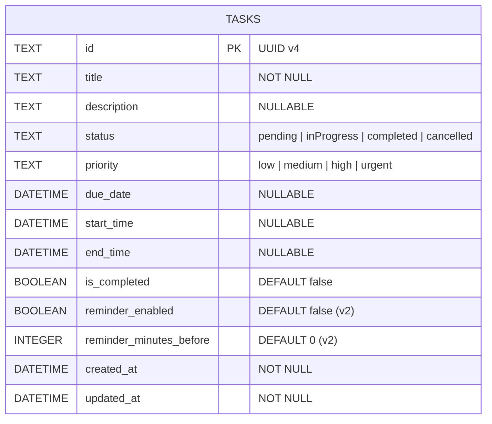

# PHẦN 6 – PHÂN TÍCH DATABASE (DATABASE DESIGN)

**Ngày phân tích:** 12/11/2026  
**File nguồn:** `lib/data/database/app_database.dart`, `lib/data/database/tables/task_table.dart`, `lib/data/database/daos/task_dao.dart`, `lib/data/repositories/task_repository_impl.dart`.

---

## 6.1. Tổng quan Database

- **Hệ quản trị:** SQLite cục bộ, file vật lý tên `timeflow.sqlite` nằm trong thư mục `getApplicationDocumentsDirectory()` (mở qua `NativeDatabase.createInBackground(file)`).
- **ORM:** Drift (`^2.18.0`, resolved `2.34.4`) với code generation (`app_database.g.dart`, `task_dao.g.dart`).
- **Schema Version hiện tại:** `2`.
- **Số lượng bảng:** Hiện tại chỉ có **1 bảng duy nhất** là `Tasks`.

---

## 6.2. Chi tiết bảng `Tasks`

Định nghĩa tại `lib/data/database/tables/task_table.dart`:

| STT | Tên cột (Dart / SQL) | Kiểu Drift / SQLite | Nullable | Mặc định | Ghi chú |
|:---:|---|---|---:|---|---|
| 1 | `id` | `TextColumn` / `TEXT` | Không | — | **Primary Key**, lưu UUID v4 |
| 2 | `title` | `TextColumn` / `TEXT` | Không | — | Tiêu đề công việc |
| 3 | `description` | `TextColumn` / `TEXT` | Có | `NULL` | Mô tả chi tiết |
| 4 | `status` | `TextColumn` / `TEXT` | Không | — | Tên enum `TaskStatus` (`pending`, `inProgress`, `completed`, `cancelled`) |
| 5 | `priority` | `TextColumn` / `TEXT` | Không | — | Tên enum `TaskPriority` (`low`, `medium`, `high`, `urgent`) |
| 6 | `dueDate` (`due_date`) | `DateTimeColumn` / `INTEGER` | Có | `NULL` | Ngày hạn của công việc |
| 7 | `startTime` (`start_time`) | `DateTimeColumn` / `INTEGER` | Có | `NULL` | Thời điểm bắt đầu |
| 8 | `endTime` (`end_time`) | `DateTimeColumn` / `INTEGER` | Có | `NULL` | Thời điểm kết thúc |
| 9 | `isCompleted` (`is_completed`) | `BoolColumn` / `INTEGER` | Không | `false` (0) | Cờ hoàn thành |
| 10 | `reminderEnabled` (`reminder_enabled`) | `BoolColumn` / `INTEGER` | Không | `false` (0) | *(Thêm ở v2)* Bật/tắt nhắc nhở |
| 11 | `reminderMinutesBefore` (`reminder_minutes_before`) | `IntColumn` / `INTEGER` | Không | `0` | *(Thêm ở v2)* Số phút nhắc trước `startTime` |
| 12 | `createdAt` (`created_at`) | `DateTimeColumn` / `INTEGER` | Không | — | Thời điểm tạo |
| 13 | `updatedAt` (`updated_at`) | `DateTimeColumn` / `INTEGER` | Không | — | Thời điểm cập nhật gần nhất |

- **Primary Key:** `{id}`.
- **Foreign Key:** Không có (vì chỉ có 1 bảng).
- **Index tùy chỉnh:** **Chưa có** index nào được khai báo ngoài Primary Key `id`.
- **Quan hệ giữa các bảng:** Chưa có quan hệ bảng (Single-table design).

---

## 6.3. Sơ đồ ERD (Entity-Relationship Diagram)

---

## 6.4. Cơ chế Migration

Trong `AppDatabase` (`lib/data/database/app_database.dart`, dòng 17–32):
- `schemaVersion => 2`.
- `onCreate`: gọi `m.createAll()` để tạo toàn bộ bảng ở phiên bản mới nhất cho người dùng cài mới.
- `onUpgrade`: nếu `from < 2`, gọi `m.addColumn(tasks, tasks.reminderEnabled)` và `m.addColumn(tasks, tasks.reminderMinutesBefore)`. Cơ chế này giữ nguyên dữ liệu cũ của người dùng từ Phase 2/3 khi nâng cấp lên Phase 4+. Đã có unit test kiểm chứng migration v1 $\rightarrow$ v2 trong `test/database_test.dart`.

---

## 6.5. Cách CRUD hoạt động & Luồng end-to-end

1. **Create:** `TaskFormDialog` $\rightarrow$ `CreateTask` usecase (validate + sinh UUID v4 + set `createdAt`/`updatedAt`) $\rightarrow$ `TaskRepositoryImpl.createTask` (map sang `TasksCompanion`) $\rightarrow$ `TaskDao.insertTask` (`InsertMode.insertOrReplace`) $\rightarrow$ SQLite.
2. **Read (Reactive):** `TaskDao.watchAllTasks()` truy vấn `SELECT * FROM tasks ORDER BY start_time ASC, created_at DESC` dưới dạng `Stream<List<Task>>`. Drift tự động phát lại danh sách mới mỗi khi có `INSERT`/`UPDATE`/`DELETE` trên bảng `tasks`.
3. **Update / Toggle:** `UpdateTask` hoặc `ToggleTaskCompletion` $\rightarrow$ `TaskDao.updateTask(entry)` sử dụng `update(tasks).replace(entry)`.
4. **Delete:** `DeleteTask` $\rightarrow$ `TaskDao.deleteTask(id)` (`DELETE FROM tasks WHERE id = ?`).

---

## 6.6. Cơ chế đảm bảo tính toàn vẹn dữ liệu & Rủi ro tiềm ẩn

### Điểm mạnh hiện tại
- **Single Source of Truth:** Android Native tuyệt đối không mở file `timeflow.sqlite` để tránh database lock hoặc race condition.
- **Validation ở UseCase:** Ngăn dữ liệu rác (`title` rỗng, `startTime >= endTime`, bật nhắc nhở khi không có `startTime`) trước khi chạm tới Repository/DB.

### Rủi ro tiềm ẩn
1. **Thiếu Index trên `dueDate`, `startTime`, `isCompleted`:** Hiện tại mọi truy vấn lọc theo ngày (`todayTasksStreamProvider`, `selectedDateTasksProvider`) đều tải **toàn bộ bảng `tasks`** vào RAM (`watchAllTasks()`) rồi lọc bằng Dart `.where(...)`. Khi dữ liệu lên vài nghìn task, hiệu năng sẽ giảm.
2. **Nguy cơ lệch trạng thái `status` và `isCompleted`:** Trong `TaskFormDialog` (dòng 182), khi sửa task, `isCompleted` được gán theo `_status == TaskStatus.completed`, nhưng nếu ở nơi khác gọi `updateTask` mà quên đồng bộ 2 trường này, dữ liệu có thể mâu thuẫn (`isCompleted = true` nhưng `status = pending`).
3. **File thừa / Dead Code gây nhầm lẫn:** `lib/core/database/app_database.dart` chỉ là file re-export dư thừa, và `lib/data/models/task_model.dart` có các trường `category`, `categoryColor` không hề tồn tại trong bảng `Tasks` của SQLite.
4. **Chưa có bảng `Categories` / `Tags` / `Subtasks`:** Schema hiện tại chưa hỗ trợ phân loại công việc hay lặp lại (recurring).

