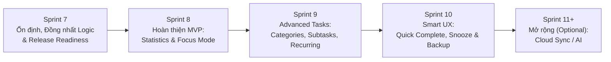

# PHẦN 11 – LỘ TRÌNH PHÁT TRIỂN TIẾP THEO (DEVELOPMENT ROADMAP)

**Ngày lập lộ trình:** 12/11/2026  
**Mục tiêu:** Xử lý triệt để các rủi ro và nợ kỹ thuật của Sprint 6.2 trước, sau đó hoàn thiện các tính năng MVP còn thiếu trên Bottom Navigation, rồi mới mở rộng sang tính năng nâng cao.

---

## Tổng quan lộ trình theo Sprint

---

### Sprint 7: Stability, Consistency & Release Readiness (Ưu tiên cao nhất — MVP Hardening)
- **Mục tiêu:** Sửa toàn bộ vấn đề `CRITICAL` và `HIGH` đã phát hiện ở Phần 9.
- **Công việc chính:**
  1. Thống nhất `currentTaskStreamProvider` và `nextTaskStreamProvider` trong `task_providers.dart` sử dụng chung `evaluateCurrentAndNextTask()` và `homeWidgetClockProvider` để Home Screen, Lockscreen Notification và Home Widget luôn hiển thị **100% giống nhau**.
  2. Xây dựng **Permission Onboarding** (dùng `keyIsFirstLaunch`) giải thích lợi ích trước khi xin `POST_NOTIFICATIONS` và kiểm tra `SCHEDULE_EXACT_ALARM`.
  3. Dọn dẹp Dead Code (`task_model.dart`, `core/database/app_database.dart`, `services/notification_service.dart`), cập nhật version string ở `SettingsScreen`.
  4. Bổ sung **Widget Tests** (`testWidgets`) cho `HomeScreen`, `TasksScreen`, `TaskFormDialog`, `CalendarScreen`.
  5. Kiểm thử thực tế Cold Reboot trên thiết bị thật / Emulator để đóng Test 18 (`BootReceiver`).
  6. Cấu hình Release Signing Keystore trong `android/app/build.gradle.kts`.
- **Độ khó:** Trung bình.
- **Tiêu chí nghiệm thu (Acceptance Criteria):**
  - `flutter analyze`: 0 issues.
  - `flutter test`: 100% PASS (bao gồm cả Widget Tests mới).
  - Test 18 (BootReceiver) PASS trên Emulator/thiết bị thật.
  - Build thành công `flutter build appbundle --release` với release keystore.

---

### Sprint 8: Hoàn thiện các Tab MVP (`StatisticsScreen` & `FocusScreen`)
- **Mục tiêu:** Xóa bỏ tình trạng tab chính trên BottomNavigationBar là màn hình placeholder.
- **Công việc chính:**
  1. **Statistics Dashboard:** Tính toán tỷ lệ hoàn thành theo ngày/tuần/tháng trực tiếp từ Drift SQLite, biểu đồ cột/tròn phân bố theo độ ưu tiên.
  2. **Focus Mode (Pomodoro):** Đồng hồ đếm ngược 25/5 phút gắn với `Current Task`, giữ trạng thái bằng notification khi xuống nền.
  3. **Time Conflict Warning:** Cảnh báo nhẹ trong `TaskFormDialog` khi người dùng tạo task trùng khung giờ với task khác.
- **Độ khó:** Trung bình.
- **Dependency:** Hoàn thành Sprint 7.
- **Tiêu chí nghiệm thu:** Tab Thống kê hiển thị số liệu thật từ SQLite; Pomodoro timer chạy chính xác và không mất state khi chuyển tab.

---

### Sprint 9: Advanced Task Management (Database Migration v3)
- **Mục tiêu:** Nâng cấp sức mạnh quản lý công việc offline.
- **Công việc chính:**
  1. Thiết kế Drift Migration v2 $\rightarrow$ v3: thêm bảng `Categories` (tên, màu sắc), `Subtasks` (checklist con), và cột `recurrenceRule` cho **Recurring Tasks**.
  2. Thêm SQLite Index trên `dueDate`, `startTime`, `isCompleted` và chuyển truy vấn lọc ngày xuống tầng SQL (`TaskDao`) thay vì lọc toàn bộ bảng trên RAM.
- **Độ khó:** Trung bình – Cao.
- **Dependency:** Sprint 8.
- **Tiêu chí nghiệm thu:** Có Unit Test Migration v2 $\rightarrow$ v3 bảo toàn 100% dữ liệu cũ; tạo task lặp lại hằng ngày hoạt động đúng.

---

### Sprint 10: Quick Actions, Snooze & Offline Backup
- **Mục tiêu:** Tối đa hóa tốc độ thao tác ngoài màn hình khóa/chính và an toàn dữ liệu.
- **Công việc chính:**
  1. Thêm nút **"Hoàn thành"** và **"Hoãn 10p" (Snooze)** trên Lockscreen Ongoing Notification / Reminder Notification.
  2. **Export / Import JSON:** Sao lưu toàn bộ database ra file `.json` và khôi phục lại không cần Internet.
- **Độ khó:** Trung bình.
- **Dependency:** Sprint 9.

---

### Sprint 11+: Cloud Sync & Optional AI (Advanced / Post-MVP)
- Chỉ triển khai khi bản Offline đã có người dùng ổn định và xác định rõ nhu cầu đồng bộ đa thiết bị (sử dụng `DioClient`, `AuthService`, `SyncService` đã tạo khung sẵn).

