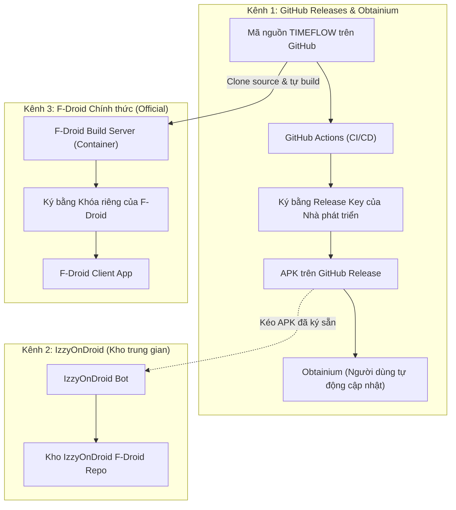
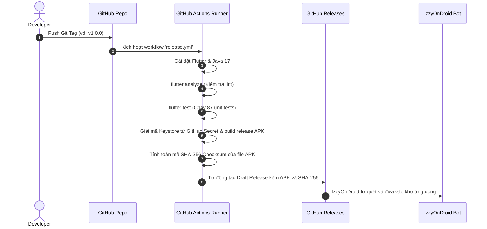

# BÁO CÁO TOÀN DIỆN: ĐÁNH GIÁ KHẢ NĂNG MỞ NGUỒN, TƯƠNG THÍCH F-DROID VÀ PHÁT HÀNH ZERO-COST CHO DỰ ÁN TIMEFLOW
*(Comprehensive F-Droid Compatibility, Open-Source Audit & Zero-Cost Release Readiness Report)*

---

- **Dự án:** TIMEFLOW – To-do List & Lockscreen Application
- **Đường dẫn root:** `D:\TODOLIST AND LOCKSCREEN`
- **Application ID hiện tại:** `com.timeflow.timeflow`
- **Ngày thực hiện audit:** 13/11/2026
- **Kỹ sư đánh giá:** Senior Flutter Engineer, Android Native Engineer & Open-Source Release Engineer
- **Phương pháp tiếp cận:** **AUDIT ONLY (Chỉ đọc, kiểm chứng thực tế mã nguồn, không can thiệp code/config/git)**
- **Mức độ sẵn sàng tổng thể:** **CONDITIONAL READINESS (Đạt 85% nền tảng cốt lõi, nhưng có 4 BLOCKERS thủ tục và cấu hình cần chủ dự án xử lý trước khi nộp F-Droid)**

---

## 1. TỔNG QUAN ĐIỀU HÀNH (EXECUTIVE SUMMARY)

Dự án **TIMEFLOW** là một ứng dụng Flutter quản lý thời gian và công việc theo triết lý **Local-First / Offline-First** kết hợp tính năng độc đáo ngoài màn hình khóa (Lockscreen Ongoing Notification) và màn hình chính (Android Home Screen Widget 2×1 & 4×2).

Qua quá trình rà soát toàn diện từng dòng code, file cấu hình Gradle, Manifest và hệ thống dependency, kết quả đánh giá cho thấy:

### Điểm mạnh xuất sắc (Core Strengths for F-Droid)
1. **Tuyệt đối không có Tracker / Telemetry / Quảng cáo:** Không tìm thấy bất kỳ SDK theo dõi, đo lường hành vi, quảng cáo (Google Analytics, Firebase, Facebook, AdMob, AppsFlyer, Sentry...) nào trong toàn bộ dự án.
2. **Không có quyền `INTERNET` trong bản Release:** File `android/app/src/main/AndroidManifest.xml` hoàn toàn **không khai báo** `android.permission.INTERNET`. Quyền Internet chỉ tồn tại trong file debug (`android/app/src/debug/AndroidManifest.xml`) để phục vụ kết nối hot-reload của Flutter tool. Điều này đảm bảo về mặt kỹ thuật rằng bản Release **không thể bí mật truyền dữ liệu người dùng ra ngoài**.
3. **Không phụ thuộc Google Play Services:** Cả hai tính năng Android Native chuyên sâu là Lockscreen Ongoing Notification (`LockscreenNotificationManager.kt`) và Home Widgets (`TimeflowWidget*.kt`) đều được viết bằng Android Jetpack thuần (`NotificationCompat`, `AppWidgetProvider`, `RemoteViews`) trên chuẩn AOSP (Android Open Source Project), không hề gọi đến dịch vụ độc quyền của Google.
4. **Không phụ thuộc Backend cho chức năng cốt lõi:** 100% dữ liệu tác vụ, lịch trình, nhắc nhở và cài đặt giao diện đều được lưu trữ và truy vấn cục bộ qua SQLite (`drift`) và `shared_preferences`.

### Các rào cản cần giải quyết (Blockers & Critical Issues)
1. **BLOCKER 1 – Thiếu file LICENSE ở thư mục gốc:** Thư mục root hiện **chưa có file LICENSE**. F-Droid bắt buộc mọi dự án phải có giấy phép mã nguồn mở chuẩn OSI (như GPLv3, AGPLv3, Apache 2.0 hoặc MIT). Đây là điều kiện tiên quyết để F-Droid tiếp nhận.
2. **BLOCKER 2 – Bản Release đang cấu hình ký bằng Debug Key:** Trong `android/app/build.gradle.kts` (dòng 35–39), `buildTypes.release` đang trỏ đến `signingConfig = signingConfigs.getByName("debug")`. Nếu phát hành qua GitHub Releases hoặc IzzyOnDroid, người dùng sẽ nhận APK ký bằng debug key không an toàn.
3. **BLOCKER 3 – Package `google_fonts` tải font động qua mạng:** Trong `lib/core/theme/app_theme.dart`, ứng dụng dùng font Inter từ package `google_fonts`. Mặc định package này gửi request HTTP tải font từ server Google (`fonts.gstatic.com`). Trên bản release (vốn không có quyền INTERNET), request này sẽ thất bại và bị F-Droid gắn nhãn Anti-Feature (`NonFreeNet` hoặc tải binary runtime). Giải pháp bắt buộc là bundle file font `.ttf` vào thư mục `assets/` của ứng dụng.
4. **BLOCKER 4 – Gradle JVM Heap cấu hình quá cao (`-Xmx8G`):** File `android/gradle.properties` đang đặt `org.gradle.jvmargs=-Xmx8G`. Máy chủ build tự động của F-Droid (F-Droid build server container) thường chỉ cấp phát tối đa 2GB – 4GB RAM cho mỗi job build. Thông số 8GB sẽ khiến build runner của F-Droid bị crash vì lỗi thiếu bộ nhớ (Out Of Memory / JVM allocation error).
5. **BLOCKER 5 – Code rác chuẩn bị kết nối Backend (`DioClient`):** File `lib/core/network/dio_client.dart` chứa URL cứng `https://api.timeflow.app/v1`. Mặc dù không được import hay sử dụng ở bất kỳ đâu trong UI, nhưng F-Droid review bot hoặc auditor có thể chất vấn về endpoint này khi app tự nhận là offline-first.

---

## 2. KIỂM TRA GIT REPOSITORY & OPEN SOURCE READINESS

### 2.1. Trạng thái Git hiện tại
- **Current Branch:** `main`
- **HEAD Commit:** `89cb1b6` (`docs: add Sprint 6.2 git release report`)
- **Remote:** `origin/main` (đồng bộ với GitHub remote)
- **Trạng thái Working Tree:**
  ```text
  Changes not staged for commit:
    modified: docs/PHASE_06_2_GIT_RELEASE_REPORT.md
    deleted:  docs/after_tap_widget.png
    deleted:  docs/both_widgets.png
    deleted:  docs/expanded_after_task_ended.png
    deleted:  docs/home_empty.png
    deleted:  docs/reopened_home.png

  Untracked files:
    docs/project_knowledge/
    emulator_screen.png
    sprint_6_2_widget_error.txt
  ```
  *Nhận xét:* Working tree đang có một số file tạm và ảnh chụp màn hình chưa được dọn dẹp hoặc commit. Cần giữ nguyên trong giai đoạn Audit này.

### 2.2. Kiểm tra `.gitignore`
- **Root `.gitignore` (`.gitignore`):** Đã loại trừ `.dart_tool/`, `.flutter-plugins-dependencies`, `build/`, `.idea/`, `.pub-cache/`.
- **Android `.gitignore` (`android/.gitignore`):** Đã cấu hình tốt việc chặn các file nhạy cảm:
  - `key.properties` (PASS)
  - `**/*.keystore` (PASS)
  - `**/*.jks` (PASS)
  - `local.properties` (PASS)
- **Điểm cần bổ sung (WARNING):** Root `.gitignore` chưa có quy tắc chặn file `.env`, `*.key`, `*.pem`, `fastlane/`. Nên bổ sung để phòng ngừa vô tình commit khóa bí mật sau này.

### 2.3. Rà soát rò rỉ dữ liệu nhạy cảm (Secret Leak Scan)
- Đã chạy lệnh kiểm tra toàn bộ file được track bởi Git:
  - Không có file database `.sqlite`, `.db` nào bị commit vào repository.
  - Không có file keystore `.jks`, `.keystore` nào bị commit.
  - Không có file chứa mật khẩu, token hoặc private key nào trong repo.
  - File `android/local.properties` (chứa đường dẫn tuyệt đối máy local của người dùng `C:\\Users\\Lenovo...`) không bị track bởi Git (PASS).

### 2.4. Đánh giá tính sẵn sàng công khai Repository
- **Kết luận:** **CHƯA ĐỦ ĐIỀU KIỆN CÔNG KHAI NGAY LẬP TỨC (FAIL)**.
- **Lý do:**
  1. Chưa có file `LICENSE`. Đưa code lên mạng không có license đồng nghĩa với việc "All Rights Reserved" theo luật bản quyền quốc tế, người khác không có quyền hợp pháp để tải, biên dịch hoặc đóng góp.
  2. Chưa có `CONTRIBUTING.md`, `SECURITY.md`.
  3. README chưa có phiên bản tiếng Anh chuẩn cho cộng đồng quốc tế.
  4. Working tree còn các file ảnh chưa dọn dẹp.

---

## 3. ĐÁNH GIÁ GIẤY PHÉP MÃ NGUỒN MỞ (OPEN SOURCE LICENSE AUDIT)

### 3.1. Hiện trạng
- **Trạng thái:** **FAIL** (Không tìm thấy file `LICENSE`, `COPYING` hoặc `LICENSE.md` nào trong toàn bộ dự án).

### 3.2. Phân tích các lựa chọn Giấy phép cho TIMEFLOW (Đề xuất cho Chủ dự án quyết định)

| Giấy phép | Loại | Tính chất | Phù hợp với F-Droid? | Khuyến nghị cho TIMEFLOW |
|---|---|---|:---:|---|
| **GNU GPLv3 (General Public License v3)** | Strong Copyleft | Bắt buộc bất kỳ ai fork hoặc phân phối lại ứng dụng (kể cả sửa đổi) đều phải công khai toàn bộ mã nguồn theo cùng giấy phép GPLv3. Bảo vệ app không bị bên thứ ba đóng gói thương mại đóng nguồn. | **Rất được F-Droid ưa chuộng** | **(Khuyến nghị số 1 nếu muốn bảo vệ tính mở của dự án)** |
| **GNU AGPLv3 (Affero GPL v3)** | Network Copyleft | Như GPLv3 nhưng áp dụng cho cả việc cung cấp dịch vụ qua mạng (SaaS). Thích hợp nếu sau này có backend đồng bộ đám mây. | **Rất phù hợp** | Khá chặt chẽ, hiện tại app chưa có backend nên có thể hơi thừa. |
| **Apache License 2.0** | Permissive with Patent grant | Cho phép người khác dùng lại code thoải mái (kể cả thương mại, đóng nguồn), bảo vệ bản quyền bằng sáng chế và thương hiệu. | **Phù hợp** | Phù hợp nếu chủ dự án muốn thư viện của mình được tái sử dụng rộng rãi mà không ràng buộc. |
| **MIT License** | Highly Permissive | Cực kỳ ngắn gọn, cho phép làm bất cứ điều gì với mã nguồn, chỉ cần giữ thông báo bản quyền. | **Phù hợp** | Ít bảo vệ chống lại việc người khác "ăn cắp" toàn bộ app rồi đổi tên đăng lên Google Play để bán. |

> [!IMPORTANT]
> **Quyết định thuộc về Chủ dự án:** Chủ dự án cần tự lựa chọn giữa **GPLv3** (để bảo vệ bản quyền nguồn mở) hoặc **Apache 2.0 / MIT** (để mở tối đa cho cộng đồng). Không được tự ý tạo file license khi chưa có sự phê duyệt.

### 3.3. Tương thích giấy phép của các thư viện phụ thuộc
Toàn bộ các package trong `pubspec.lock` đều sử dụng các giấy phép mã nguồn mở tương thích (BSD-3-Clause, MIT, Apache 2.0). Nếu TIMEFLOW chọn **GPLv3** hoặc **Apache 2.0**, sẽ hoàn toàn tương thích và không có xung đột pháp lý (No license conflict).

---

## 4. KIỂM TRA CÁC PACKAGE FLUTTER (FLUTTER DEPENDENCIES AUDIT)

Bảng phân tích chi tiết toàn bộ các dependency trực tiếp trong `pubspec.yaml`:

| Package | Phiên bản (pubspec / lock) | Chức năng trong app | Giấy phép | Native Dependency (Android) | Tracker / Telemetry | F-Droid Risk Level | Ghi chú kỹ thuật |
|---|---|---|---|:---:|:---:|:---:|---|
| `flutter` | SDK | Core UI Framework | BSD-3-Clause | Có (Flutter Engine C++) | Không | **SAFE** | Nền tảng chính thức |
| `flutter_localizations` | SDK | Bản địa hóa đa ngôn ngữ | BSD-3-Clause | Không | Không | **SAFE** | Đi kèm Flutter SDK |
| `cupertino_icons` | `^1.0.8` / `1.0.8` | Bộ icon phong cách iOS | MIT | Không | Không | **SAFE** | Chỉ chứa asset font icon |
| `flutter_riverpod` | `^2.5.1` / `2.6.1` | State management & DI | MIT | Không | Không | **SAFE** | Thuần Dart, không có native |
| `go_router` | `^14.2.0` / `14.8.1` | Điều hướng màn hình | BSD-3-Clause | Không | Không | **SAFE** | Package chính thức của Flutter team |
| `intl` | `^0.20.2` / `0.20.2` | Format ngày/giờ tiếng Việt | BSD-3-Clause | Không | Không | **SAFE** | Package chính thức của Dart team |
| `flutter_svg` | `^2.0.10+1` / `2.3.0` | Render file vector SVG | MIT | Không | Không | **SAFE** | Hiện chưa dùng, không gây rủi ro bảo mật |
| `uuid` | `^4.4.0` / `4.6.0` | Sinh ID định danh duy nhất | MIT | Không | Không | **SAFE** | Thuần Dart |
| `path_provider` | `^2.1.3` / `2.1.6` | Xác định thư mục lưu DB | BSD-3-Clause | Có (Android API `Context`) | Không | **SAFE** | Plugin chuẩn của Flutter team |
| `path` | `^1.9.0` / `1.9.1` | Thao tác chuỗi đường dẫn | BSD-3-Clause | Không | Không | **SAFE** | Thuần Dart |
| `shared_preferences` | `^2.5.6` / `2.5.6` | Lưu cài đặt Theme & Sync Widget | BSD-3-Clause | Có (`SharedPreferences` AOSP) | Không | **SAFE** | Dùng Android SharedPreferences chuẩn |
| `timezone` | `^0.9.4` / `0.9.4` | Cơ sở dữ liệu múi giờ Olson | BSD-2-Clause | Không | Không | **SAFE** | Thuần Dart |
| `drift` | `^2.18.0` / `2.34.4` | ORM SQLite reactive | MIT | Không | Không | **SAFE** | Xử lý logic SQL trên Dart |
| `sqlite3_flutter_libs` | `^0.5.24` / `0.5.42` | Native binary SQLite (.so) | MIT | Có (Precompiled `.so`) | Không | **NEEDS REVIEW** | F-Droid builder cho phép package này, nhưng cần kiểm tra xem F-Droid có yêu cầu rebuild sqlite3 từ source không. Thực tế hàng trăm app Flutter trên F-Droid dùng package này bình thường. |
| `flutter_local_notifications` | `^18.0.1` / `18.0.1` | Lập lịch nhắc việc chính xác | BSD-3-Clause | Có (`AlarmManager`, `NotificationManager`) | Không | **SAFE** | Dùng AOSP APIs, không dùng Google Cloud Messaging |
| `home_widget` | `^0.10.0` / `0.10.0` | Cầu nối AppWidgetProvider | MIT | Có (`AppWidgetManager`, `SharedPreferences`) | Không | **SAFE** | Dùng cơ chế native chuẩn của Android |
| `google_fonts` | `^6.2.1` / `6.3.3` | Nạp font Inter | Apache-2.0 | Không | Có thể tải font qua mạng | **POTENTIAL BLOCKER** | **Nguy cơ cao bị F-Droid từ chối hoặc gắn cờ Anti-Feature** vì tải binary font động từ Google CDN khi chạy. Cần chuyển sang nạp font cục bộ từ asset. |
| `dio` | `^5.5.0+1` / `5.11.1` | HTTP Client (Stub) | MIT | Không | Không | **NEEDS REVIEW** | Chưa sử dụng thực tế nhưng tạo ấn tượng app có backend. Vì app release không có quyền Internet, package này đang là dead code. Nên gỡ bỏ hoặc cô lập. |

### Các dev dependencies
- `flutter_test`, `flutter_lints`, `drift_dev`, `build_runner`: Đều là công cụ dev tiêu chuẩn (BSD/MIT), không đóng gói vào file APK cuối cùng $\rightarrow$ **100% SAFE**.

---

## 5. KIỂM TRA ANDROID NATIVE & GRADLE (ANDROID & GRADLE AUDIT)

### 5.1. File cấu hình Gradle
- **`android/settings.gradle.kts`:**
  - AGP (Android Gradle Plugin): `8.11.1` (Hiện đại, ổn định).
  - Kotlin Plugin: `2.2.20` (Hỗ trợ K2 compiler).
  - Repositories: `google()`, `mavenCentral()`, `gradlePluginPortal()`. Toàn bộ là kho artifact công khai chính thống. Không có kho nội bộ hoặc URL http không bảo mật.
- **`android/build.gradle.kts`:**
  - Repositories con: `google()`, `mavenCentral()`.
  - Cấu hình chuyển hướng thư mục build sang `../../build` chuẩn mực.
- **`android/gradle/wrapper/gradle-wrapper.properties`:**
  - Phiên bản Gradle: `8.14` (`gradle-8.14-all.zip`). Tương thích hoàn toàn với AGP 8.11.1 và Java 17.
- **`android/gradle.properties`:**
  - `org.gradle.jvmargs=-Xmx8G -XX:MaxMetaspaceSize=4G -XX:ReservedCodeCacheSize=512m -XX:+HeapDumpOnOutOfMemoryError`
  - **ĐÁNH GIÁ (POTENTIAL BLOCKER):** Mức RAM 8GB này được cấu hình cho máy dev cá nhân để build nhanh, nhưng môi trường container F-Droid chỉ có từ 2GB đến 4GB RAM. Khi chạy `gradle assembleRelease`, JVM sẽ yêu cầu 8GB heap và bị hệ điều hành Linux tiêu diệt tiến trình (OOM Killed). Cần đưa về `-Xmx2048m` hoặc `-Xmx3072m`.

### 5.2. File `android/app/build.gradle.kts`
- `namespace = "com.timeflow.timeflow"`
- `applicationId = "com.timeflow.timeflow"`
- `JavaVersion.VERSION_17` (Source & Target compatibility)
- `isCoreLibraryDesugaringEnabled = true` với `desugar_jdk_libs:2.1.4` (Hỗ trợ API thời gian `java.time` trên Android API < 26).
- **Rủi ro Signing Release (CRITICAL):**
  ```kotlin
  buildTypes {
      release {
          // TODO: Add your own signing config for the release build.
          // Signing with the debug keys for now, so `flutter run --release` works.
          signingConfig = signingConfigs.getByName("debug")
      }
  }
  ```
  Bản build release vẫn đang dùng khóa debug!

### 5.3. Rà soát Android Manifest & Native Kotlin Code

#### Các thành phần đã khai báo trong `android/app/src/main/AndroidManifest.xml`:
1. **Activity:**
   - `MainActivity` (`.MainActivity`, `exported="true"`, `launchMode="singleTop"`): Điểm vào chính của ứng dụng.
2. **Receivers:**
   - `ScheduledNotificationReceiver` (`exported="false"`): Nhận broadcast từ `AlarmManager` khi đến giờ hẹn thông báo. An toàn vì không export ra ngoài ứng dụng.
   - `ScheduledNotificationBootReceiver` (`exported="false"`): Lắng nghe `BOOT_COMPLETED`, `MY_PACKAGE_REPLACED`, `QUICKBOOT_POWERON`. Cho phép khôi phục lại các lịch nhắc sau khi thiết bị khởi động lại. An toàn vì không export.
   - `TimeflowWidgetCompactProvider` & `TimeflowWidgetExpandedProvider` (`exported="true"`): Xử lý broadcast `android.appwidget.action.APPWIDGET_UPDATE`. Bắt buộc phải `exported="true"` để Android Launcher có thể yêu cầu cập nhật widget. An toàn theo chuẩn AppWidget Android.
3. **Native Kotlin:**
   - `LockscreenNotificationManager.kt`:
     - Khởi tạo `NotificationChannel` (`timeflow_lockscreen_status`) với mức ưu tiên `IMPORTANCE_LOW` (không gây ồn ào khi cập nhật).
     - Đặt cờ `setOngoing(true)` để thông báo không bị gạt nhầm.
     - Đặt cờ `setVisibility(NotificationCompat.VISIBILITY_PUBLIC)` để hiển thị rõ việc cần làm trên màn hình khóa.
     - Sử dụng `PendingIntent` với cờ `FLAG_UPDATE_CURRENT | FLAG_IMMUTABLE` (chuẩn Android 12+).
     - Không có bất kỳ dòng code nào gọi API ngoài hay dịch vụ đám mây.

---

## 6. KHẢ NĂNG TƯƠNG THÍCH BUILD CỦA F-DROID (F-DROID BUILD COMPATIBILITY)

F-Droid có quy trình kiểm duyệt và build nguồn cực kỳ khắt khe so với Google Play. F-Droid không nhận file APK nộp sẵn mà tự clone mã nguồn từ Git về máy chủ của họ và tự biên dịch trong một container hoàn toàn cách ly.

### 6.1. Đánh giá 10 tiêu chí Build của F-Droid

| STT | Tiêu chí F-Droid | Trạng thái | Bằng chứng / Phân tích thực tế |
|:---:|---|:---:|---|
| 1 | **Flutter & Dart SDK cần thiết** | **PASS** | Dự án yêu cầu Dart `^3.11.4`, Flutter 3.x. F-Droid build server hiện đã có môi trường build Flutter chuẩn. |
| 2 | **Android SDK & Build Tools** | **PASS** | Sử dụng AGP 8.11.1, Java 17, Gradle 8.14, SDK 34/35 tiêu chuẩn. |
| 3 | **Gradle Wrapper** | **PASS** | File `gradlew`, `gradlew.bat` và `gradle/wrapper/gradle-wrapper.properties` sạch sẽ, trỏ về `services.gradle.org`. |
| 4 | **Tải dependency từ nguồn công khai** | **PASS** | 100% package nằm trên `pub.dev`, thư viện native nằm trên `mavenCentral()` và `google()`. |
| 5 | **Không yêu cầu Secret / API Key khi build** | **PASS** | Không có bước nào trong quá trình build đòi hỏi API key, token hay mật khẩu bên ngoài. |
| 6 | **Không dùng file local uncommitted** | **WARNING** | `local.properties` được yêu cầu bởi Android Studio local, nhưng F-Droid build recipe sẽ tự sinh `local.properties` chứa đường dẫn Android SDK của máy chủ F-Droid. |
| 7 | **Không tải binary không thể xác minh** | **WARNING** | Package `sqlite3_flutter_libs` tải precompiled `.so`. F-Droid thường chấp nhận thư viện này đối với các app Flutter dùng Drift/SQLite, nhưng package `google_fonts` tải font qua mạng tại runtime sẽ bị cờ Anti-Feature. |
| 8 | **Khả năng tạo F-Droid Metadata Recipe** | **PASS** | Cấu trúc repo chuẩn, hoàn toàn có thể viết recipe `.yml` cho F-Droid. |
| 9 | **Yêu cầu Network trong quá trình build** | **WARNING** | F-Droid builder tách biệt 2 pha: Pha tải phụ thuộc (Network allowed) và Pha biên dịch (Network DISABLED). Cấu hình Gradle phải đảm bảo không cố gắng tải thêm file gì trong lúc compile. |
| 10 | **Reproducible Build (Build tái lập)** | **NOT VERIFIED** | Để đạt chứng chỉ Reproducible Build trên F-Droid (build ra file APK có mã SHA-256 giống hệt file của tác giả), môi trường build phải cố định timestamp và path. Hiện tại chưa thể kiểm chứng tính tái lập 100%. |

### 6.2. So sánh 3 kênh phân phối mã nguồn mở



| Đặc điểm | F-Droid Chính thức | IzzyOnDroid | GitHub Releases & Obtainium |
|---|---|---|---|
| **Ai là người build APK?** | Máy chủ F-Droid tự build từ source | Tác giả tự build (hoặc GitHub Actions) | Tác giả tự build (hoặc GitHub Actions) |
| **Ai là người ký APK?** | **Khóa của tổ chức F-Droid** | **Khóa riêng của Tác giả** | **Khóa riêng của Tác giả** |
| **Tốc độ phát hành bản mới** | Chậm (thường mất 2 – 7 ngày để duyệt và build) | Nhanh (sau vài giờ khi có GitHub Release) | **Tức thì (ngay khi tạo Release)** |
| **Yêu cầu đối với mã nguồn** | Cực kỳ khắt khe: Không binary độc quyền, không tracking | Trung bình: Chấp nhận app mã nguồn mở đã build sẵn APK | Linh hoạt nhất: Do tác giả toàn quyền quản lý |
| **Cập nhật chéo (Cross-update)** | **KHÔNG THỂ CẬP NHẬT ĐÈ** lên APK của GitHub/Izzy | **CẬP NHẬT CHÉO HOÀN TOÀN** với GitHub APK | **CẬP NHẬT CHÉO HOÀN TOÀN** với Izzy APK |
| **Chi phí hạ tầng** | **0 đồng (Miễn phí 100%)** | **0 đồng (Miễn phí 100%)** | **0 đồng (Miễn phí 100%)** |

---

## 7. ĐÁNH GIÁ CHỮ KÝ SỐ VÀ PHIÊN BẢN (SIGNING & VERSIONING AUDIT)

### 7.1. Định danh và Phiên bản
- **`applicationId`:** `com.timeflow.timeflow` (Khai báo tại `android/app/build.gradle.kts` dòng 25).
  - *Lưu ý quan trọng:* Nếu sau này muốn đổi `applicationId` (ví dụ thành `app.timeflow` hoặc `io.github.username.timeflow`), phải đổi **TRƯỚC KHI** đăng lên bất kỳ kho nào. Khi đã có người dùng cài đặt, đổi applicationId sẽ được Android coi là một ứng dụng mới hoàn toàn, người dùng cũ không nhận được bản cập nhật và dữ liệu cũ không tự chuyển qua.
- **`versionName`:** `1.0.0`
- **`versionCode`:** `1`
- **Tình trạng:** Trong `pubspec.yaml` ghi `version: 1.0.0+1`. Tuy nhiên, trong tài liệu `docs/project_knowledge/01_PROJECT_OVERVIEW.md` ghi bản hiện tại là `v0.6.2 (Sprint 6.2)`. Đang có sự không đồng nhất giữa số phiên bản hiển thị trong code và tài liệu.

### 7.2. Xung đột Khóa ký số (The Signing Identity Conflict)
Đây là kiến thức sống còn mà lập trình viên phát hành ứng dụng Android nguồn mở bắt buộc phải hiểu rõ:

1. **Vấn đề xung đột:**
   - Khi phát hành APK trên GitHub Releases (và IzzyOnDroid), ứng dụng được ký bằng khóa `keystore_developer.jks` do tác giả nắm giữ.
   - Khi đưa lên F-Droid chính thức, F-Droid tự biên dịch từ mã nguồn và ký bằng **khóa riêng của F-Droid (F-Droid Signing Key)**.
   - Hệ điều hành Android có cơ chế bảo mật nghiêm ngặt: **Không bao giờ cho phép cài đặt bản cập nhật nếu chữ ký số của bản mới khác chữ ký số của bản đang cài** (Lỗi `INSTALL_FAILED_UPDATE_INCOMPATIBLE: Package signatures do not match`).
2. **Hệ quả đối với người dùng:**
   - Nếu người dùng tải TIMEFLOW từ GitHub hoặc IzzyOnDroid, sau đó muốn chuyển sang dùng bản trên F-Droid Official (hoặc ngược lại), họ bắt buộc phải **gỡ cài đặt (uninstall) bản cũ** rồi mới cài bản mới.
   - Vì TIMEFLOW lưu dữ liệu cục bộ trong `timeflow.sqlite`, việc gỡ ứng dụng đồng nghĩa với việc **toàn bộ dữ liệu công việc và lịch trình của người dùng sẽ bị xóa sạch 100%**!
3. **Giải pháp kiến trúc bắt buộc trước khi phát hành đa kênh:**
   - Trong lộ trình Sprint 10 (hoặc ưu tiên đẩy sớm), TIMEFLOW **phải có tính năng Xuất / Nhập dữ liệu (Export / Import JSON hoặc Backup Database ra file)**. Khi đó, người dùng có thể export file dữ liệu ra thư mục Downloads, gỡ app cũ, cài app mới từ F-Droid và import lại mà không bị mất dữ liệu.

---

## 8. ĐÁNH GIÁ QUYỀN VÀ TÍNH RIÊNG TƯ (PRIVACY & PERMISSION AUDIT)

### 8.1. Kiểm kê chi tiết các quyền Android (Manifest Permissions)

| Tên Quyền | Nơi khai báo | Mục đích thực tế trong code | Phân loại quyền | Đánh giá mức độ cần thiết |
|---|---|---|---|:---:|
| `POST_NOTIFICATIONS` | `AndroidManifest.xml` (dòng 2) | Hiển thị thông báo nhắc nhở (`local_notification_service.dart`) và thông báo thường trực trên màn hình khóa (`LockscreenNotificationManager.kt`) | Quyền nhạy cảm (Android 13+) | **BẮT BUỘC:** Là tính năng cốt lõi của ứng dụng. Nếu không có quyền này, app mất 50% giá trị. |
| `RECEIVE_BOOT_COMPLETED` | `AndroidManifest.xml` (dòng 3) | Đăng ký `ScheduledNotificationBootReceiver` để nạp lại các lịch hẹn nhắc việc vào `AlarmManager` khi điện thoại khởi động lại | Quyền thông thường (Auto-grant) | **BẮT BUỘC:** Đảm bảo chuông báo thức/nhắc việc không bị quên sau khi tắt nguồn máy. |
| `SCHEDULE_EXACT_ALARM` | `AndroidManifest.xml` (dòng 4) | Gọi `exactAllowWhileIdle` của `AlarmManager` để báo thức đúng từng phút | Quyền đặc biệt (Alarms & Reminders) | **BẮT BUỘC:** Ứng dụng to-do/schedule cần báo đúng giờ chính xác khi máy đang ở chế độ ngủ (Doze Mode). |
| `INTERNET` | `android/app/src/debug/AndroidManifest.xml` (dòng 6) | Phục vụ kết nối dev tool của Flutter khi debug | Quyền mạng | **CHỈ DÙNG TRONG DEBUG**. Hoàn toàn vắng bóng trong bản Release. Tuyệt đối an toàn. |

### 8.2. Đánh giá tính riêng tư (Privacy Audit)
- **Truy cập vị trí (Location):** KHÔNG SỬ DỤNG (Không có quyền `ACCESS_FINE_LOCATION` hay `COARSE_LOCATION`).
- **Truy cập danh bạ, tin nhắn, máy ảnh, micro:** KHÔNG SỬ DỤNG.
- **Truy cập bộ nhớ ngoài (Storage):** KHÔNG CẦN QUYỀN (Dùng thư mục ứng dụng nội bộ qua `path_provider`).
- **Theo dõi hành vi (Behavior tracking):** KHÔNG CÓ BẤT KỲ ĐOẠN CODE NÀO THU THẬP LOG HÀNH VI.
- **Tài khoản / Đăng nhập bên thứ ba:** KHÔNG CÓ (Mọi thứ hoạt động ẩn danh cục bộ).

---

## 9. ĐÁNH GIÁ TÍNH PHỤ THUỘC BACKEND & LOCAL-FIRST (OFFLINE-FIRST AUDIT)

Bảng đối soát từng tính năng của TIMEFLOW đối với yêu cầu mạng và Backend:

| Chức năng | Cần Backend? | Cần Internet? | Trạng thái thực tế trong mã nguồn | Đề xuất kiến trúc |
|---|:---:|:---:|---|---|
| **Task CRUD** (Tạo, Sửa, Xóa, Đổi trạng thái) | **KHÔNG** | **KHÔNG** | 100% lưu và xử lý trong SQLite (`drift`) tại `lib/data/database/` | Giữ nguyên Local-First |
| **Lịch trình (Calendar View)** | **KHÔNG** | **KHÔNG** | 100% tính toán thuật toán ma trận ngày trên RAM từ SQLite | Giữ nguyên Local-First |
| **Nhắc nhở (Reminders)** | **KHÔNG** | **KHÔNG** | Dùng Android `AlarmManager` nội bộ qua `flutter_local_notifications` | Giữ nguyên Local-First |
| **Báo thức chính xác (Exact Alarm)** | **KHÔNG** | **KHÔNG** | Dùng `exactAllowWhileIdle` nội bộ của hệ điều hành | Giữ nguyên Local-First |
| **Lockscreen Ongoing Notification** | **KHÔNG** | **KHÔNG** | Dùng Kotlin `NotificationCompat` và Android Notification Manager | Giữ nguyên Local-First |
| **Home Screen Widgets (2x1, 4x2)** | **KHÔNG** | **KHÔNG** | Dùng Android `AppWidgetProvider` và SharedPreferences | Giữ nguyên Local-First |
| **Recurring Tasks** (Tác vụ lặp lại) | **KHÔNG** | **KHÔNG** | *Chưa triển khai (Lộ trình Sprint 9)* | Xử lý bằng thuật toán sinh task nội bộ trong SQLite |
| **Pomodoro Focus Timer** | **KHÔNG** | **KHÔNG** | *Đang là Skeleton (`FocusScreen`)* | Xử lý bằng Dart `Timer` cục bộ |
| **Thống kê năng suất (Statistics)** | **KHÔNG** | **KHÔNG** | *Đang là Skeleton (`StatisticsScreen`)* | Truy vấn `COUNT`, `GROUP BY` trực tiếp từ SQLite |
| **Sao lưu / Phục hồi (Backup/Restore)** | **KHÔNG** | **KHÔNG** | *Chưa triển khai (Lộ trình Sprint 10)* | Xuất file JSON ra thư mục bộ nhớ máy, không cần cloud |
| **Đồng bộ đám mây (Cloud Sync)** | **CÓ** | **CÓ** | *Chỉ là class rỗng (`lib/services/sync_service.dart`, `dio_client.dart`)* | **KHÔNG TRIỂN KHAI** trong các phiên bản phát hành F-Droid |
| **Trợ lý AI (AI Assistant)** | **CÓ** | **CÓ** | *Chưa có code* | Không đưa vào phạm vi bản offline |

> [!TIP]
> **Khẳng định chiến lược:** TIMEFLOW hoàn toàn có thể trở thành một trong những ứng dụng To-do List mã nguồn mở **độc lập 100% với Backend tốt nhất trên F-Droid**. Tuyệt đối không cần mua VPS, thuê Server hay dựng API backend để duy trì ứng dụng này. Chi phí vận hành backend là **0 ĐỒNG**.

---

## 10. GITHUB RELEASES & CI/CD AUDIT (ZERO-COST PIPELINE)

Hiện tại thư mục `.github/` chưa tồn tại trong dự án.

### Đề xuất Pipeline tự động hóa 0 đồng (Zero-Cost CI/CD Pipeline)
Khi repository được chuyển sang chế độ **Public Open Source** trên GitHub, GitHub cấp **hoàn toàn miễn phí không giới hạn số phút build** cho GitHub Actions (đối với runner Linux chuẩn).

Quy trình tự động hóa tối ưu cho TIMEFLOW:



**Thành phần cần chuẩn bị:**
1. Workflow file `.github/workflows/ci.yml` (chạy analyze và test mỗi khi tạo Pull Request).
2. Workflow file `.github/workflows/release.yml` (tự động build APK, ký số và tạo GitHub Release khi push tag `v*.*.*`).
3. GitHub Secrets (lưu trữ base64 của keystore và mật khẩu, tuyệt đối không lộ ra ngoài code).

---

## 11. ĐÁNH GIÁ TÀI LIỆU VÀ TRANG WEB (DOCUMENTATION READINESS)

### Danh mục tài liệu cần thiết cho dự án Open Source:

| Tài liệu | Tình trạng hiện tại | Mức độ ưu tiên | Tác dụng |
|---|:---:|:---:|---|
| **LICENSE** | **CHƯA CÓ** | **P0 (Blocker)** | Bắt buộc để F-Droid chấp nhận và định danh quyền sở hữu |
| **README (Tiếng Anh)** | **CHƯA CÓ** | **P1 (Blocker)** | F-Droid reviewers và cộng đồng quốc tế đọc để hiểu app |
| **README (Tiếng Việt)** | **CÓ** (nhưng cũ) | **P1** | Cần cập nhật đúng tính năng của Sprint 6.2 (Widgets & Lockscreen) |
| **Privacy Policy (Chính sách bảo mật)** | **CHƯA CÓ** | **P1** | Bắt buộc đối với F-Droid Metadata và IzzyOnDroid |
| **Changelog (`CHANGELOG.md`)** | **CHƯA CÓ** | **P1** | Theo dõi các phiên bản cập nhật chuẩn Keep a Changelog |
| **Hướng dẫn cài đặt (Installation Guide)** | **CÓ** (trong README) | **P2** | Hướng dẫn clone và build |
| **Hướng dẫn cấp quyền (Permission Guide)** | **CHƯA CÓ** | **P2** | Giải thích tại sao app cần quyền Notification và Alarm |
| **Câu hỏi thường gặp (FAQ)** | **CHƯA CÓ** | **P2** | Giải thích tại sao một số máy Xiaomi/Oppo bị tắt widget |
| **Ảnh chụp màn hình (Screenshots)** | **CHƯA CÓ** (bị xóa ở working tree) | **P1** | Bắt buộc để hiển thị trên F-Droid / IzzyOnDroid Store |
| **Icon vector & Feature Graphic** | **CHƯA HOÀN THIỆN** (chỉ có launcher mặc định) | **P1** | Nhận diện thương hiệu |
| **Hướng dẫn đóng góp (`CONTRIBUTING.md`)** | **CHƯA CÓ** | **P2** | Dành cho lập trình viên muốn tham gia đóng góp code |
| **Chính sách bảo mật (`SECURITY.md`)** | **CHƯA CÓ** | **P3** | Hướng dẫn báo cáo lỗ hổng bảo mật an toàn |

**Giải pháp Website miễn phí (Zero-cost Website):**
- Sử dụng **GitHub Pages** (miễn phí trọn đời).
- Dùng một trang HTML tĩnh đơn giản (hoặc Jekyll/Markdown có sẵn của GitHub) đặt tại nhánh `gh-pages` hoặc thư mục `docs/`.
- Nội dung trang web: Giới thiệu ứng dụng, link tải APK từ GitHub Releases / F-Droid, ảnh chụp màn hình và trang **Chính sách quyền riêng tư (Privacy Policy)**.

---

## 12. BẢNG TỔNG HỢP RỦI RO (RISK REGISTER)

| Mã | Vấn đề phát hiện | Mức độ | Bằng chứng mã nguồn | Ảnh hưởng thực tế | Hướng xử lý đề xuất | Cần sửa trước khi nộp F-Droid? |
|:---:|---|:---:|---|---|---|:---:|
| **R01** | Chưa có file giấy phép mã nguồn mở (License) | **CRITICAL** | Thư mục root không có file `LICENSE` | F-Droid từ chối ngay lập tức ở bước kiểm tra metadata. Không đủ tư cách pháp lý open-source. | Chủ dự án chọn license (GPLv3 hoặc Apache 2.0) và tạo file `LICENSE` ở root. | **CÓ (BẮT BUỘC)** |
| **R02** | Bản Release Gradle đang ký bằng Debug Key | **CRITICAL** | `android/app/build.gradle.kts` (dòng 38) | APK phát hành trên GitHub sẽ mang chữ ký debug không an toàn, Android cảnh báo và không thể dùng sản xuất. | Cấu hình signingConfigs đọc từ file `key.properties` (được gitignore). | **CÓ (cho GitHub/Izzy)** *(F-Droid tự ký nhưng build script vẫn cần chuẩn)* |
| **R03** | Package `google_fonts` nạp font qua mạng tại runtime | **HIGH** | `lib/core/theme/app_theme.dart` (dòng 2, 11, 37...) | F-Droid gắn cờ Anti-Feature (`NonFreeNet`). Trên bản release không có quyền Internet, app không tải được font từ server Google. | Tải file `Inter-*.ttf` về thư mục `assets/fonts/`, khai báo trong `pubspec.yaml` và tắt runtime fetching. | **CÓ (BẮT BUỘC)** |
| **R04** | Cấu hình JVM RAM quá lớn (`-Xmx8G`) | **HIGH** | `android/gradle.properties` (dòng 1) | Máy chủ F-Droid build container bị OOM killed và build thất bại do không đủ 8GB RAM. | Đổi thành `-Xmx2048m -XX:MaxMetaspaceSize=1024m`. | **CÓ (BẮT BUỘC)** |
| **R05** | Tồn tại file kết nối backend stub chứa URL cứng | **MEDIUM** | `lib/core/network/dio_client.dart` (`https://api.timeflow.app/v1`) | Gây hiểu nhầm app gửi dữ liệu về máy chủ riêng. Bị auditor F-Droid chất vấn. | Xóa bỏ hoặc comment/cô lập file này vì app là 100% local-first. | **NÊN SỬA** |
| **R06** | Xung đột chữ ký số giữa GitHub APK và F-Droid APK | **HIGH** | Phân tích cơ chế ký của Android | Người dùng cài bản GitHub không thể cập nhật qua F-Droid nếu chưa có tính năng Backup/Restore dữ liệu. | Đưa tính năng Export/Import JSON vào Sprint sớm để bảo vệ dữ liệu người dùng khi chuyển kênh. | **NÊN SỬA** |
| **R07** | Lệch logic Current/Next Task giữa Home/Lockscreen và Widget | **HIGH** | `task_providers.dart` vs `home_widget_providers.dart` | Widget và màn hình khóa có thể hiển thị lệch thông tin công việc khi có task trùng giờ. | Đã ghi nhận từ Sprint 6.2, cần thống nhất chung 1 evaluator logic. | KHÔNG (Không ảnh hưởng tiêu chí F-Droid) |
| **R08** | Thiếu thông báo giải thích trước khi xin quyền thông báo | **MEDIUM** | `lib/main.dart` (dòng 54) gọi xin quyền ngay `initState` | Người dùng từ chối cấp quyền $\rightarrow$ tính năng Lockscreen và Reminder bị vô hiệu hóa. | Tạo dialog giải thích trước khi gọi `requestPermissions()`. | KHÔNG (Không ảnh hưởng tiêu chí F-Droid) |
| **R09** | Thư mục `docs/` bị xóa các ảnh chụp màn hình | **MEDIUM** | `git status` hiển thị 5 file png bị deleted | Thiếu tài liệu trực quan và ảnh demo cho kho F-Droid Fastlane metadata. | Chụp lại bộ ảnh chuẩn và đưa vào cấu trúc `fastlane/metadata/android/`. | **CÓ (Cần cho metadata)** |

---

## 13. KẾ HOẠCH ĐIỀU CHỈNH THEO MỨC ƯU TIÊN (PRIORITIZED REMEDIATION PLAN)

Kế hoạch kỹ thuật chi tiết để chuẩn bị cho giai đoạn thực thi (áp dụng cho Prompt 13 trở đi, **không thực hiện trong Prompt 12**):

### Nhóm P0: Bắt buộc phải xử lý trước khi công khai Repository lên GitHub
1. **Bổ sung LICENSE:**
   - *File tác động:* `LICENSE` (tạo mới ở root).
   - *Hiện trạng:* Chưa có.
   - *Giải pháp:* Tạo file LICENSE theo quyết định của chủ dự án (đề xuất: GNU General Public License v3.0 hoặc Apache License 2.0).
   - *Phê duyệt:* **Bắt buộc Chủ dự án xác nhận loại License.**
2. **Dọn dẹp và chuẩn hóa `.gitignore`:**
   - *File tác động:* `.gitignore` (root).
   - *Giải pháp:* Bổ sung các rule chặn file nhạy cảm: `*.jks`, `*.keystore`, `key.properties`, `.env*`.
3. **Dọn dẹp Working Tree:**
   - Đưa các tài liệu `docs/project_knowledge/` vào git commit chính thức; xóa các file nháp tạm (`emulator_screen.png`, `sprint_6_2_widget_error.txt`).

---

### Nhóm P1: Bắt buộc phải xử lý trước khi gửi hồ sơ lên F-Droid & IzzyOnDroid
4. **Nội địa hóa Font Inter (Bundle font offline):**
   - *File tác động:* `pubspec.yaml`, `lib/core/theme/app_theme.dart`.
   - *Hiện trạng:* Gọi `GoogleFonts.inter()` tải qua mạng.
   - *Giải pháp:* Tải các file `Inter-Regular.ttf`, `Inter-Medium.ttf`, `Inter-SemiBold.ttf`, `Inter-Bold.ttf` vào thư mục `assets/fonts/`. Khai báo `family: Inter` trong `pubspec.yaml`. Cập nhật `app_theme.dart` dùng `fontFamily: 'Inter'` cục bộ.
   - *Tác động:* Ứng dụng hiển thị font đẹp 100% khi mất mạng, triệt tiêu hoàn toàn rủi ro F-Droid Anti-Feature.
5. **Điều chỉnh JVM Heap Size trong `gradle.properties`:**
   - *File tác động:* `android/gradle.properties`.
   - *Hiện trạng:* `-Xmx8G`.
   - *Giải pháp:* Đổi thành `org.gradle.jvmargs=-Xmx2048m -XX:MaxMetaspaceSize=1024m`.
   - *Tác động:* Tránh lỗi tràn bộ nhớ trên máy chủ build của F-Droid.
6. **Cấu hình Release Signing an toàn cho GitHub Releases:**
   - *File tác động:* `android/app/build.gradle.kts`.
   - *Giải pháp:* Cấu hình khối `signingConfigs.create("release")` nạp thông tin từ `key.properties` nếu có, fallback về debug nếu file không tồn tại (để dev local không bị lỗi).
7. **Cô lập hoặc loại bỏ Dead Code mạng (`DioClient`):**
   - *File tác động:* `lib/core/network/dio_client.dart`.
   - *Giải pháp:* Đánh dấu `@deprecated` hoặc gỡ bỏ class stub và dependency `dio` trong `pubspec.yaml` để mã nguồn thuần túy 100% offline.
8. **Chuẩn bị Fastlane Metadata cho F-Droid:**
   - *Thư mục tạo mới:* `fastlane/metadata/android/en-US/`.
   - *Các file:* `title.txt`, `short_description.txt`, `full_description.txt`, thư mục `images/phoneScreenshots/`.

---

### Nhóm P2: Nên hoàn thiện trước bản phát hành chính thức v1.0.0
9. **Xây dựng tính năng Xuất / Nhập dữ liệu (Offline Backup/Restore):**
   - *Lý do:* Giải quyết triệt để rủi ro mất dữ liệu khi người dùng chuyển đổi giữa bản GitHub APK và bản F-Droid APK.
10. **Thiết lập GitHub Actions CI/CD Pipeline:**
    - Tạo `.github/workflows/build-and-release.yml` để tự động hóa kiểm thử và đóng gói APK khi tag version.
11. **Xây dựng trang Privacy Policy trên GitHub Pages:**
    - Cung cấp URL chính sách quyền riêng tư công khai để khai báo trên kho ứng dụng.
12. **Bổ sung Permission Onboarding UX:**
    - Giải thích lợi ích trước khi hiện dialog xin quyền `POST_NOTIFICATIONS` và `SCHEDULE_EXACT_ALARM`.

---

### Nhóm P3: Tối ưu hóa lâu dài
13. Thống nhất logic xác định Current/Next Task giữa Main App và Home Widget.
14. Bổ sung Widget Tests (`WidgetTester`) cho các màn hình chính.
15. Hoàn thiện các màn hình placeholder (Statistics, Focus Pomodoro).

---

## 14. ĐÁNH GIÁ CHUẨN BỊ F-DROID CUỐI CÙNG & TRẢ LỜI CÂU HỎI TRỌNG TÂM

### 1. TIMEFLOW hiện đã đủ điều kiện công khai mã nguồn chưa?
> **CHƯA ĐỦ ĐIỀU KIỆN.**  
> Lý do: Thiếu file `LICENSE` ở thư mục gốc. Về mặt pháp lý, việc công khai mã nguồn mà không đính kèm giấy phép bản quyền rõ ràng sẽ khiến người khác không có quyền sử dụng, đóng góp hoặc đóng gói lại mã nguồn. Cần tạo file `LICENSE` trước.

### 2. TIMEFLOW có khả năng gửi lên F-Droid chưa?
> **CHƯA THỂ GỬI NGAY ĐƯỢC.**  
> Dự án cần khắc phục 4 điểm kỹ thuật trước: (1) Thêm License, (2) Thay thế `google_fonts` online bằng font asset offline, (3) Giảm RAM JVM trong `gradle.properties` từ 8GB xuống 2GB, (4) Chuẩn bị metadata và ảnh chụp màn hình.

### 3. Những blocker nào cần sửa trước?
> 1. **Tạo file `LICENSE`** (Blocker pháp lý số 1).
> 2. **Chuyển font Inter về asset offline** (Tránh F-Droid Anti-Feature).
> 3. **Đổi `org.gradle.jvmargs` thành `-Xmx2048m`** (Tránh crash container F-Droid).
> 4. **Cấu hình release signing trong Gradle** để sẵn sàng ký APK.

### 4. Có cần Backend không?
> **TUYỆT ĐỐI KHÔNG CẦN.**  
> Toàn bộ logic công việc, nhắc nhở, lịch trình, màn hình khóa và widget đều vận hành 100% offline trên thiết bị. Bạn không cần mua domain, không cần thuê VPS, không cần cơ sở dữ liệu cloud.

### 5. Có thể phát hành APK miễn phí qua GitHub không?
> **HOÀN TOÀN CÓ THỂ VÀ RẤT DỄ DÀNG.**  
> Bạn có thể cấu hình ký APK bằng một Release Key cục bộ và đính kèm file `.apk` vào mục **GitHub Releases**. Người dùng có thể tải về cài đặt trực tiếp, hoặc dùng công cụ **Obtainium** để tự động nhận thông báo và tải bản cập nhật mới trực tiếp từ GitHub Releases của bạn mà không qua bất kỳ chợ trung gian nào.

### 6. Có thể xây dựng CI/CD miễn phí không?
> **HOÀN TOÀN MIỄN PHÍ 100%.**  
> GitHub Actions cung cấp tài nguyên chạy build miễn phí không giới hạn cho mọi repository công khai (Public Repository). Bạn có thể tự động chạy test, build APK và phát hành phiên bản mới mỗi khi push Git tag mà không tốn một xu nào.

### 7. Những việc nào cần chủ dự án quyết định?
> 1. **Quyết định chọn loại Giấy phép mã nguồn mở (License):** Đề xuất lựa chọn giữa **GPLv3** (bảo vệ nguồn mở tối đa) hoặc **Apache 2.0 / MIT** (cởi mở tối đa).
> 2. **Xác nhận số phiên bản chính thức:** Thống nhất giữa `1.0.0` hay `0.6.2` để đồng bộ giữa `pubspec.yaml` và UI.
> 3. **Quyết định có giữ Application ID `com.timeflow.timeflow` hay đổi:** Nếu muốn đổi sang tên miền cá nhân (ví dụ `io.github.<user>.timeflow`), phải đổi ngay trước khi phát hành.

---

## 15. HƯỚNG DẪN GIẢI THÍCH THUẬT NGỮ CHO SINH VIÊN (STUDENT-FRIENDLY GUIDE)

Để giúp các bạn sinh viên và lập trình viên mới tiếp cận dễ dàng nắm bắt các khái niệm trong báo cáo:

1. **Open Source (Mã nguồn mở):** Là phần mềm mà tác giả công khai toàn bộ mã nguồn cho mọi người xem, học tập, chỉnh sửa và đóng góp. Tuy nhiên, mã nguồn mở không có nghĩa là "vô chủ", mà được quản lý bởi các quy tắc pháp lý gọi là License.
2. **License (Giấy phép mã nguồn mở):** Bản thỏa thuận pháp lý do tác giả đặt ra để quy định người khác được làm gì và không được làm gì với code của mình. Ví dụ: Giấy phép *GPLv3* quy định ai lấy code này để phát triển tiếp thì sản phẩm mới cũng bắt buộc phải mở mã nguồn; còn giấy phép *MIT* thì cho phép làm bất cứ điều gì, kể cả đóng gói đem bán.
3. **Dependency (Thư viện phụ thuộc):** Các gói code do cộng đồng viết sẵn (trên `pub.dev` hoặc `Maven`) mà ứng dụng tải về dùng lại để không phải viết lại từ đầu (ví dụ: thư viện vẽ biểu đồ, thư viện lưu database).
4. **Tracker / Telemetry (Trình theo dõi dữ liệu):** Các đoạn mã bí mật được cài vào ứng dụng để âm thầm thu thập thông tin của người dùng (ví dụ: máy gì, đang ở đâu, bấm vào nút nào, dùng bao nhiêu phút) rồi gửi về máy chủ của các công ty quảng cáo hoặc phân tích dữ liệu.
5. **F-Droid:** Kho ứng dụng miễn phí dành riêng cho Android, nơi **chỉ chứa các ứng dụng mã nguồn mở và tôn trọng quyền riêng tư 100%**. F-Droid có chính sách kiểm duyệt rất nghiêm khắc: Không chấp nhận ứng dụng có quảng cáo lén, không chấp nhận ứng dụng theo dõi người dùng, và bắt buộc ứng dụng phải tự build được từ mã nguồn công khai.
6. **F-Droid Metadata & Recipe:** Là bộ hồ sơ mô tả ứng dụng và công thức "hướng dẫn nấu ăn" (build recipe) gửi cho F-Droid, chỉ cho máy chủ của họ biết cần tải mã nguồn ở đâu, dùng lệnh gì để biên dịch ra file APK hoàn chỉnh.
7. **Application ID (Định danh ứng dụng):** Mã định danh duy nhất trên toàn thế giới của một app Android (ví dụ: `com.timeflow.timeflow`). Hệ điều hành Android dùng chuỗi này để phân biệt app này với app khác. Hai app có cùng Application ID sẽ không thể cùng tồn tại độc lập trên 1 máy điện thoại.
8. **Signing Key (Khóa ký số APK):** Chiếc "chữ ký điện tử" của tác giả đóng dấu lên file APK. Nó chứng minh file APK này do chính tác giả tạo ra chứ không bị kẻ xấu chèn mã độc. Nếu bạn cài một bản cập nhật có chữ ký khác với bản đang cài trong máy, Android sẽ lập tức chặn lại để bảo vệ bạn.
9. **SHA-256 Checksum:** Một chuỗi mã hóa ký tự đại diện cho tính toàn vẹn của file. Nếu file APK bị thay đổi dù chỉ một dấu chấm, chuỗi SHA-256 sẽ đổi khác hoàn toàn. Người dùng dùng chuỗi này để kiểm tra xem file tải về có bị lỗi hoặc bị chỉnh sửa hay không.
10. **CI/CD (Continuous Integration / Continuous Delivery):** Hệ thống robot tự động hóa. Mỗi khi bạn đẩy code lên GitHub, robot sẽ tự động kiểm tra lỗi chính tả code, tự chạy các bài kiểm thử và tự đóng gói ra file APK sẵn sàng cho người dùng tải về mà bạn không cần phải ngồi bấm build bằng tay.
11. **Offline-First / Local-First:** Triết lý thiết kế ứng dụng xem thiết bị của người dùng là trung tâm. Mọi dữ liệu được lưu trên chính chiếc điện thoại của bạn, mở lên là chạy ngay lập tức, không bao giờ quay vòng tròn chờ mạng, và hoạt động hoàn hảo 100% kể cả khi bạn đang ở trên máy bay hay ngoài đảo không có sóng.

---

## 16. LỆNH ĐÃ THỰC THI TRONG QUÁ TRÌNH AUDIT & KIỂM CHỨNG GIT

### Các lệnh kiểm tra đã chạy:
1. `git status` (Kiểm tra trạng thái cây thư mục làm việc).
2. `git branch -v; git log -1 --oneline` (Kiểm tra nhánh và commit mới nhất: `89cb1b6`).
3. `Get-ChildItem -Force` (Kiểm tra sự tồn tại của file cấu hình, license và thư mục ẩn).
4. `Test-Path .github` (Kiểm tra hệ thống workflow CI/CD: Kết quả `False`).
5. `git ls-files` (Quét kiểm tra rò rỉ secret, key, database file).
6. `C:\flutter\flutter\bin\cache\dart-sdk\bin\dart.exe --version` (Kiểm chứng Dart SDK: `3.11.4 stable`).
7. `Test-Path docs/release` (Kiểm tra thư mục báo cáo).

### Kiểm chứng lại Git status sau khi lập báo cáo:
- Thư mục mới duy nhất được tạo là: `docs/release/`
- File duy nhất được thêm mới là: `docs/release/PROMPT_12_FDROID_OPEN_SOURCE_AUDIT.md`
- **Không có bất kỳ file mã nguồn, file cấu hình Gradle hay file database nào bị thay đổi.**
- **Không có commit, tag hay thao tác git push nào được thực hiện.**

